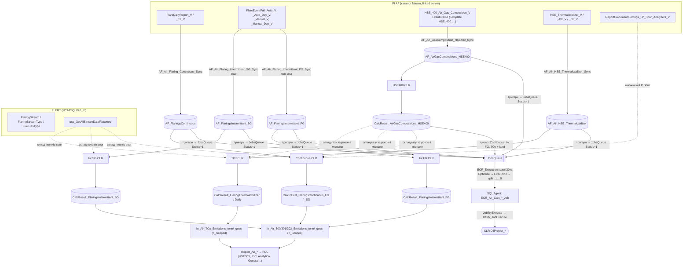

# ECR: повний потік даних факелів 30X, HSE400 і Thermaloxidizer

> Довідник: як дані факелів (HSE 300/301/302: Continuous, Intermittent FG, Intermittent SG), складу газу HSE400 і термоокислювача (TOx, HSE 372) проходять шлях **PI AF → SQL → черга → CLR-асемблі → CalcResult → функції → SSRS-звіти**. Окремо описано нічний цикл, архівацію, моніторинг і відомі вади.
>
> **Джерела.** Скрипт схеми `SQL/DB.txt` і джобів `SQL/Jobs.txt` (обидва від 24.11.2026), код збірки `Assembly/DllProject/DllProject/`, RDL у `SSRS/ECR/01. Production/01. Air/`, практичний прогін на UAT (NCATUATV12) 25.11.2026. Посилання у форматі `DB:NNNN` / `Jobs:NNNN` — це рядки в цих файлах, `Файл.cs:NN` — шлях відносно `Assembly/DllProject/DllProject/`.
>
> **Застереження.** Опис зроблено статично, по коду. Значення в таблицях-налаштуваннях (`Settings`, `JobsList.Split`, AF-методології) у скрипті не зберігаються, тому про них написано як «за кодом». Усе, що підтверджено прогоном, позначено **[перевірено на UAT]**.

---

## Зміст

1. [Загальна схема](#1-загальна-схема)
2. [Інфраструктура: linked server, налаштування, FLERT, звітний період](#2-інфраструктура)
3. [Бік PI AF: що й звідки читається](#3-бік-pi-af)
4. [Синк-процедури PI AF → AF-таблиці](#4-синк-процедури)
5. [Хто й коли запускає синки](#5-хто-й-коли-запускає-синки)
6. [AF-таблиці (вхід)](#6-af-таблиці-вхід)
7. [Тригери](#7-тригери)
8. [Черга джобів і виконання](#8-черга-джобів-і-виконання)
9. [CLR: спільна інфраструктура](#9-clr-спільна-інфраструктура)
10. [CLR: HSE400, склад газу](#10-clr-hse400)
11. [CLR: Continuous 30X (FG, SG, HSE300)](#11-clr-continuous-30x)
12. [CLR: Intermittent FG](#12-clr-intermittent-fg)
13. [CLR: Intermittent SG](#13-clr-intermittent-sg)
14. [CLR: Thermaloxidizer (місячний і добовий)](#14-clr-thermaloxidizer)
15. [CalcResult-таблиці, Merge, табличні типи](#15-calcresult-таблиці)
16. [Залежності та каскад розрахунків](#16-залежності-та-каскад)
17. [Нічний і повний перерахунок](#17-нічний-і-повний-перерахунок)
18. [Ручний перерахунок і кнопка на дашборді](#18-ручний-перерахунок)
19. [Архівація в `_History`](#19-архівація)
20. [Споживачі: функції, процедури звітів, RDL](#20-споживачі)
21. [Моніторинг і діагностика](#21-моніторинг-і-діагностика)
22. [Ключі збігу та поведінка, коли даних немає](#22-ключі-збігу)
23. [Відомі вади та ризики](#23-відомі-вади-та-ризики)
24. [Практика: перерахунок минулого року](#24-практика-перерахунок-минулого-року)
25. [Довідник об'єктів](#25-довідник-обєктів)

---

## 1. Загальна схема



Коротко:
1. **Синк.** Щохвилинний `ECR_Sync_Common_Job` викликає синк HSE400, потім запускає `ECR_Air_Sync_HSE3XX_Job` (Continuous, Int FG, Int SG, TOx). Вікно синку — звітний період.
2. **Тригери AF-таблиць.** На кожну вставку чи зміну ставлять відповідний розрахунковий джоб у `JobsQueue`.
3. **Черга.** `ECR_Execution` раз на 30 с зливає вікна, що перекриваються, ділить факельні джоби на 5 дочірніх і запускає SQL Agent-джоби.
4. **Розрахунок.** Джоб викликає CLR-процедуру. Вона чистить старі результати за EFID, читає вхід, рахує формули з AF і робить merge у `CalcResult_*`.
5. **Каскад HSE400.** Запис результатів HSE400 через тригер ставить у чергу Continuous, Int FG, TOx і land-джоби.
6. **Нічний цикл о 01:15.** Повний ресинк звітного періоду, `TRUNCATE` усіх `CalcResult_*`, потім перерахунок з нуля.
7. **Архів.** При зсуві звітного періоду дані переносяться в `_History`. Читачі зазвичай беруть live UNION `_History`, але не всі (див. [§19](#19-архівація)).

---

## 2. Інфраструктура

### 2.1 Налаштування та linked server
- **`ufnGetSetting(@Parameter)`** (`DB:16024`): повертає `Settings.Value` за `Parameter`, `TOP 1 ORDER BY CASE WHEN Status=1 THEN 0 ELSE 1 END, ID`. Таблиця `Settings(ID, Parameter, Description, Value, Status bit)` (`DB:15998`).
- **Два способи вибрати linked server:**
  - Факели 30X (`*_Data_Get`, `*_Data_Get_Check`, `*_ID_Get`): `ufnGetSetting(N'AFServFlert')`. Значення налаштування і є ім'ям linked server.
  - HSE400, TOx, `AF_Air_Flaring_LP_Sour_Analyzers_UsingGas_Get`: подвійна індирекція `ufnGetSetting(ufnGetSetting(N'Mode'))`. `Mode` містить назву іншого параметра, а вже його значення — ім'я linked server.
- **Шаблон запиту в PI** однаковий для всіх: `SELECT * FROM OPENQUERY(<LinkedServer>, '<RTQP>')`, каталог `@AFCatalog = N'Master'`, в'юхи `[Master].[Category].*_V`, виконання через `sp_executesql`. Текст запиту пишеться в `LogRunQuery(NameProc, Query)`.

### 2.2 FLERT
- **Синоніми** (`DB:10400-10406`):
  - `Flert_FlaringStream` → `[NCATSQLV42_PI].[FLERT].[dbo].[FlaringStream]`;
  - `Flert_FlaringStreamType` → `...[FlaringStreamType]`;
  - `Flert_FuelGasType` → `...[FuelGasType]`.

  Перебудовуються кроком 17 «Rebuild Flert Synonyms» джоба `ECR_Sync_Common_Job` (`EXEC dbo.Utility_RebindFlertSynonyms`).
- **`Flert_GetAllStreamDataFlattened`** (`DB:87875`): читає `Settings.FlertServer` і `Settings.FlertMode` (`LINKED` або `LOCAL`, за замовчуванням LINKED). Виконує `EXEC [srv].[FLERT].[dbo].[usp_GetAllStreamDataFlattened]` або локальний `[Flert].[dbo].[...]`. У CLR результат стає моделлю `FlertAllDataVersions`: Stream_ID, StreamNumber, StreamType, IsOnshore, GasComposition_ID, ValidFrom/ValidTo, склад, Density, MW. NULL у ValidFrom стає `MinValue`, у ValidTo — `MaxValue`.

### 2.3 Звітний період і водяний знак
- **`Utility_GetDefaultStartEndDates`** (`DB:139704`): `TOP 1` з `AF_CurrentReportPeriod ORDER BY ID DESC`; Start = `StartDateTime`, End = `DATEADD(MINUTE,-1,EndDateTime)`. Цю межу використовують синки, тригери і нічний перерахунок.
- **`AF_CurrentReportPeriod`** оновлює `AF_CurrentReportPeriod_Sync` (`DB:71523`) щохвилини з джоба `ECR Sync_ReportAndTransfer` (`Jobs:659`). Він читає AF `Settings_General_V` (Calculation_Start/EndDateTime). Якщо новий Start пізніший за збережений, запускає архівацію (див. [§19](#19-архівація)).
- **`Utility_GetDefaultStartAnd400EndDates`** (`DB:139667`): Start береться зі звітного періоду, End — кінець місяця останнього `AF_AirGasCompositions_HSE400.Time`. Використовується в перевірках.
- **`ufnGetSyncStartDateTime(@ProcedureName, @ReportStartDateTime, @OffsetMs=100)`** (`DB:10505`):
  - бере `WatchdogStatus.LastUpdateEF` за Name, а якщо NULL — `WatchdogStatus_Land.LastUpdateEF`;
  - віднімає `@OffsetMs` мс;
  - якщо результат NULL або раніший за `@ReportStartDateTime`, повертає `@ReportStartDateTime`.

  З п'яти синків цього розділу водяний знак використовує **лише TOx**.

---

## 3. Бік PI AF

### 3.1 Continuous (добовий звіт факелів)

| Процедура | Рядок | Що читає |
|---|---|---|
| `AF_Air_Flaring_Continuous_Data_Get @StartDateTime, @EndDateTime` | `DB:31048` | `[Master].[Category].[FlareDailyReport_V]`. Колонки `ID, Modified, StartTime, Fuel_Type_ID` і 14 значень: `AIsland_HP_Purge/Pilot`, `DIsland_HP_Purge/Pilot`, `DIsland_LP_Purge/Pilot`, `Onshore_HP_Purge/Pilot`, `Onshore_LP_Purge/Pilot`, `Onshore_HP_Sweet_Analyzers`, `Onshore_LP_Sweet_Analyzers`, `DIsland_LP_Sour_Analyzers`, `Onshore_LP_Sour_Analyzers`. Фільтр `StartTime BETWEEN` (формат 120). Guard: `Start >= End` → RETURN. |
| `AF_Air_Flaring_Continuous_Data_Get_Check` | `DB:31090` | `ID, StartTime` з тієї ж в'юхи. |
| `AF_Air_Flaring_Continuous_ID_Get` | `DB:31137` | `SELECT ID FROM [Master].[Category].[FlareDailyReport_EF_V] WHERE StartTime BETWEEN …` («migrated 2026-06-10»). ID беруться з **іншої в'юхи `_EF_V`**, ніж дані. |

Один EF відповідає одній добі. За рік їх 365 **[перевірено на UAT: 2025 = 365]**.

### 3.2 Intermittent FG (non-sour) і SG (sour)

Обидва типи читають ті самі 4 в'юхи через `UNION ALL`:
- `FlareEventFull_Auto_V`, `FlareEventFull_Auto_Day_V` (isAuto=1);
- `FlareEventFull_Manual_V`, `FlareEventFull_Manual_Day_V` (isAuto=0).

Колонки: `Area, Location, StartTime, Modified, ID, EndTime, Duration, Unit, Equipment, TagNumber, Category, FluidDepressurized, GasCompositionID, Stream, StreamType, AdjustedV Total, isAuto`.

| Процедура | Рядок | Фільтр |
|---|---|---|
| `AF_Air_Flaring_Intermittent_FG_Data_Get` | `DB:31550` | `EndTime IS NOT NULL AND StartTime BETWEEN … AND INSTR(FluidDepressurized, N'sour',1,1) = 0` |
| `..._FG_Data_Get_Check` | `DB:31600` | `ID, StartTime`, ті самі фільтри |
| `AF_Air_Flaring_Intermittent_FG_ID_Get` | `DB:31656` | `INSTR(...)=0`, **без** `EndTime IS NOT NULL`: cleanup бачить і ще не закриті події |
| `AF_Air_Flaring_Intermittent_SG_Data_Get` / `_Check` / `_ID_Get` | `DB:32122` / `32172` / `32228` | те саме, але `INSTR(...) > 0`; у `ID_Get` теж без `EndTime IS NOT NULL` |

**[Перевірено на UAT]:** за 2025 рік у PI 8 482 події FG і 3 590 SG.

### 3.3 LP Sour Analyzers (для Continuous SG і звітів 302)
- **`AF_Air_Flaring_LP_Sour_Analyzers_UsingGas_Get`** (`DB:32594`), режим `Mode`.
- Запит: `SELECT Path + Name AS Element, LP_Sour_Analyzers_StreamIDs, SInfo_StartDate, SInfo_EndDate FROM [Master].[Category].[ReportCalculationSettings_LP_Sour_Analyzers_V]`.
- Без фільтра дат і без логування.
- Формат `LP_Sour_Analyzers_StreamIDs`: `"id:coef;id:coef"`.

### 3.4 HSE400
| Процедура | Рядок | Що читає |
|---|---|---|
| `AF_Air_GasComposition_HSE400_Data_Get` | `DB:32729` | `[Master].[Category].[HSE_400_Air_Gas_Composition_V]`: `ID, Modified, Time, Attribute_00010 … Attribute_04270` (~186 атрибутів). Фільтр `StartTime > start AND StartTime <= end` (формат 121): **лівий край виключено**. |
| `..._Data_Get_Check` | `DB:32775` | `ID, Time`, `StartTime BETWEEN` (120) |
| `AF_Air_GasComposition_HSE400_ID_Get` | `DB:32815` | `SELECT ef.ID FROM [Master].[EventFrame].[EventFrame] ef WHERE ef.Template = N'HSE_400_Air_Gas_Composition' AND ef.StartTime BETWEEN …`. Читає саму таблицю EF за шаблоном, не в'юху. |

Один EF містить склад газу за місяць. **[Перевірено на UAT]:** за 2025 рік у PI лише 6 EF (липень–грудень).

### 3.5 Thermaloxidizer
| Процедура | Рядок | Що читає |
|---|---|---|
| `AF_Air_HSE_Thermaloxidizer_Data_Get` | `DB:35209` | `HSE_Thermaloxidizer_V`: `ID EFID, Modified, Time, A0010…A1240, File_Name, MethodCalculation, Sheet_Name`, `StartTime > … AND <= …`. **Синк її не викликає** (див. [§4.5](#45-af_air_hse_thermaloxidizer_sync)). |
| `..._Data_Get_Check` | `DB:35250` | `ID EFID, StartTime`, `BETWEEN` |
| `AF_Air_HSE_Thermaloxidizer_ID_Get` | `DB:35291` | `SELECT ID FROM [Master].[Category].[HSE_Thermaloxidizer_EF_V] WHERE StartTime BETWEEN …` |

**[Перевірено на UAT]:** за 2025 рік у PI 0 EF.

---

## 4. Синк-процедури

Загальна модель: PI → табличка-буфер `@TempData` → `MERGE` в AF-таблицю → «reconcile-DELETE» (видалити з таблиці рядки вікна, яких уже немає в PI) → каскад або прибирання осиротілих `CalcResult`.

### 4.1 `AF_Air_Flaring_Continuous_Sync @StartDateTime, @EndDateTime` (`DB:31175-31440`)
1. **Guard:** NULL або `Start >= End` → RETURN (`31198`).
2. **Applock** (`31202`): `sp_getapplock @Resource=@ProcedureName, Exclusive, LockOwner=Session, LockTimeout=0`. Якщо зайнято — `LogRunQuery 'SKIPPED: another instance…'` і RETURN. **Виклик мовчки пропускається, помилки немає.**
3. **Watchdog** (`31220-31247`): рядок у `WatchdogStatus` за Name, `IsBusy=1` (новий рядок отримує `JobId=1`), в окремій транзакції `WatchdogTransaction`.
4. **Читання:** `@TempData ← EXEC AF_Air_Flaring_Continuous_Data_Get` (`31274`); `@ExistingEFIDs` = рядки `AF_FlaringsContinuous` з `StartTime BETWEEN @Start AND @End` (`31281`).
5. **DIAG** у `LogRunQuery`: `DIAG Src=… AF_in_window=… Range …` (`31287`).
6. **MERGE** (`31293`): `ON EFID`; `WHEN MATCHED AND target.ModifiedTime < source.ModifiedTime` → UPDATE усіх колонок; `WHEN NOT MATCHED BY TARGET` → INSERT. Гілки `BY SOURCE` немає.
7. **Reconcile-DELETE** (`31326-31368`) із запобіжниками:
   - `@SrcCnt=0 AND @ExiCnt>0` → пропуск, `RECONCILE-DELETE SKIPPED: source EMPTY`;
   - `@ExiCnt>0 AND @SrcCnt*2 < @ExiCnt` → пропуск, `source implausibly small`;
   - інакше `BEGIN TRAN ReconcileDelete`: `DELETE … OUTPUT deleted.EFID INTO @DeletedEFIDs WHERE StartTime BETWEEN … AND NOT EXISTS(source)`, потім явний каскад `DELETE CalcResult_FlaringsContinuous_FG/_SG` за `@DeletedEFIDs` (`31356-31360`), лог, COMMIT.
8. **Orphan sweep** (`31376-31397`), той самий гейт: `DELETE CalcResult_FlaringsContinuous_FG/_SG WHERE [DateTime] BETWEEN … AND EFID NOT IN AF_FlaringsContinuous AND NOT IN AF_FlaringsContinuous_History`.
9. **Завершення:** watchdog `IsBusy=0`, лог успіху, `sp_releaseapplock`. CATCH: скинути watchdog, ROLLBACK, лог, release, RAISERROR.
10. **Водяного знака немає**, щоразу синкається повне вікно.

### 4.2 `AF_Air_Flaring_Intermittent_FG_Sync` (`DB:31704-32011`)
Каркас той самий: applock, watchdog, DIAG, запобіжники, каскад, orphan sweep. Відмінності:
- **Збагачення `@TempData`:**
  - `IsOnshore = CHARINDEX('onsho', Location)>0`;
  - `IsSour = CHARINDEX('sour', FluidDepressurized)>0` (`31815`);
  - `IsHMB` береться з `Flert_FlaringStream.isHMB` лише при `IsSour=1 AND isAuto=1`. Для FG це завжди 0 (`31821-31830`);
  - `FlareUnit` визначається через CASE за `Location`: `'a islan'` / `'D island - hp'` / `'D island - lp'` / `'Onshore - hp'` / `'Onshore - lp'`, інакше `'ERROR'` (`31832-31851`).
- **Вікно existing/delete:** `StartTime >= @Start AND EndTime <= @End` (`31858`, `31928`). Подію, що закінчується після `@End`, reconcile не чіпає.
- **MERGE** (`31870`): `WHEN MATCHED AND target.ModifiedTime < source.ModifiedTime AND source.EndTime IS NOT NULL`; `Total = round(Total,10)`.
- **Каскад і orphan:** лише `CalcResult_FlaringsIntermittent_FG`, проти `AF_FlaringsIntermittent_FG` і `_History` (`31937`, `31957-31961`).

### 4.3 `AF_Air_Flaring_Intermittent_SG_Sync` (`DB:32276-32584`)
Те саме, що FG. Відрізняється тільки `IsHMB` (`32393-32403`):
- `IsSour=1 AND isAuto=1` → за `FS.Id=GasCompositionID`: спершу з тим самим `isOnshore`, потім без нього;
- `IsSour=1 AND isAuto=0 AND GasCompositionID<>0` → за Id;
- `IsSour=1 AND isAuto=0` → за `FS.name = Stream`;
- інакше 0.

Каскад і orphan: `CalcResult_FlaringsIntermittent_SG`.

### 4.4 `AF_Air_GasComposition_HSE400_Sync` (`DB:32866-33742`), стара схема
- **Немає applock, DIAG, запобіжників reconcile, явного каскаду й orphan sweep.**
- `@ProcedureName = 'AF_Air_Flaring_GasComposition_HSE400_Sync'` (`32880`) **не збігається з іменем процедури**. Записи у `WatchdogStatus` і `LogRunQuery` йдуть під цим іменем.
- `@TempData` має 186 типізованих колонок (`FG_Makat_*`, `FG_HMB_*`, `LPG_HMB_*`, `FG_Export_*`, `FG_Internal_*`, `LPG_Internal_*`) ← `EXEC AF_Air_GasComposition_HSE400_Data_Get` (`33115`).
- `@ExistingEFIDs` обчислюється (`33121`), але не використовується.
- **MERGE** (`33123`): `ON EFID`; `WHEN MATCHED AND target.ModifiedTime < source.ModifiedTime` → UPDATE з `round(…,20)`; `NOT MATCHED BY TARGET` → INSERT (`33317`).
- **Reconcile-DELETE без запобіжників** (`33699-33702`): `DELETE AF_AirGasCompositions_HSE400 WHERE Time BETWEEN @Start AND @End AND NOT EXISTS(@TempData)`.
  - Порожня відповідь PI видалить усе у вікні.
  - Джерело фільтрує `StartTime > @Start`, а видалення — `Time BETWEEN`: рядок з `Time = @Start` не приходить і видаляється.
- **Каскад на CalcResult** відбувається лише через FK `FK_CalcResult_AF ... ON DELETE CASCADE` (див. [§15](#15-calcresult-таблиці)).
- Водяного знака немає.

### 4.5 `AF_Air_HSE_Thermaloxidizer_Sync @StartDateTime, @EndDateTime` (`DB:35363-35915`)

> ⚠️ **Небезпечна процедура.** Викликати її з вікном, відмінним від поточного звітного періоду, не можна (див. крок 1).

- **Watchdog** через `AF_Land_Watchdog_Initialize(@ProcedureName, @TemplateName='HSE_Thermaloxidizer', @JobId OUT, @WatchdogID OUT)` (`35382`; процедура `DB:73225`): шукає або вставляє `JobsList(Name='HSE_Thermaloxidizer', Type='Get/Sync')`, викликає `Utility_CheckTriggerStatus`, пише у **`WatchdogStatus_Land`**.
- **Applock немає.**
- **Водяний знак:** `@LastUpdateDateTime = ufnGetSyncStartDateTime(@ProcedureName, @Start, 100)` (`35414`).
- **Крок 1** (`35430-35442`):
  - `#Start ← EXEC AF_Air_HSE_Thermaloxidizer_ID_Get(@Start,@End)`;
  - `IF EXISTS(#Start) DELETE FROM AF_Air_HSE_Thermaloxidizer WHERE EFID NOT IN (SELECT EFID FROM #Start)`.
  - **Фільтра дат немає.** Видаляються всі EFID, яких немає у вікні, зокрема дані інших років. Синк за 2025 рік стер би весь TOx 2026-го.
  - Тригер на DELETE чистить місячний `CalcResult_FlaringThermaloxidizer`, але не Daily.
- **Крок 3:** власний OPENQUERY до `[Master].[Category].[HSE_Thermaloxidizer_V] WHERE StartTime BETWEEN …` → `#RawData` (`35561-35570`), потім `SELECT EFID, ATID, AttributeName FROM [Master].[Category].[HSE_Thermaloxidizer_Attr_V]` → `#AttrIDs` (`35572`).
  - OPENQUERY віддає `File_Name, Sheet_Name, MethodCalculation`, а `#RawData` оголошена як `File_Name, MethodCalculation, Sheet_Name`. INSERT у `#Input` переставляє колонки ще раз (`35590-35592`), тож дві перестановки компенсують одна одну.
- **Unpivot** `A0010…A1240` через `CROSS APPLY VALUES` (`35594`); `ATID = ISNULL(a.ATID, NEWID())`.
  - Фільтр: `ParameterValue NOT NULL / <> '' / <> 'NULL' AND CHARINDEX(';', ParameterValue) > 0` (`35638`). Це запобіжник від недоматеріалізованих EF, доданий 22.09.2026.
  - Пропущені EF пишуться в `JobsLog` як попередження (`35650-35672`).
- **Розбір рядка:** `dbo.ufnSplit(ParameterValue, ';')`, `MAXRECURSION 0` (`35685`). Pivot на 32 слоти через `TRY_CAST DECIMAL(25,16)` (`35690-35727`):
  - rn 1 = Train, 2 = Date, 3 = Mode, 4 = Type, 5 = FG_152_Type …;
  - 30 = EmSO2_tonn, 31 = EmSO2_OperTime, 32 = Equiv_Daily_Emissions.
- **Фільтр за водяним знаком:** `WHERE ModifiedTime > @LastUpdateDateTime` (`35758`), повторно в USING (`35771`).
- **MERGE** (`35768`): `ON target.EFID = source.EFID AND target.ATID = source.ATID`; `WHEN MATCHED AND ModifiedTime <` → UPDATE з `ROUND(…,16)`; `NOT MATCHED BY TARGET` → INSERT. Гілки delete немає.
- **Оновлення водяного знака** (`35850-35866`): `UPDATE WatchdogStatus SET LastUpdateEF = MAX(#TempTable.ModifiedTime) WHERE Name=@ProcedureName`. Якщо NULL — MAX із самої таблиці.
- **Розбіжність таблиць watchdog:** init пише в `WatchdogStatus_Land`, а фінальний (`35871`) і CATCH (`35881`) `UPDATE` роблять `WatchdogStatus … WHERE ID=@WatchdogID` у **не-Land** таблиці. Під цей ID може потрапити чужий рядок, а `IsBusy` у `_Land` лишається 1.
- **Помилки** пишуться в `JobsLog` (не в `LogRunQuery`), потім RAISERROR.

---

## 5. Хто й коли запускає синки

| Хто | Де | Розклад (фактичний) | Що робить |
|---|---|---|---|
| `ECR_Sync_Common_Job` | `Jobs:8248` | розклад названо «10m», але фактично **щохвилини** з 05:30 (`freq_subday_type=4, interval=1`) | 22 кроки. Серед них: 17 — Rebuild Flert Synonyms; «Sync_SourAnalyzers. Use for report» (`sp_Sync_SourAnalyzers_Cache`, `Jobs:8515`); 21 — `AF_Air_GasComposition_HSE400_Sync @StartDate,@EndDate` (звітний період, `Jobs:8584`); 22 — `sp_start_job N'ECR_Air_Sync_HSE3XX_Job'` (асинхронно, `Jobs:8599`) |
| `ECR_Air_Sync_HSE3XX_Job` | `Jobs:6261` | власного розкладу немає, стартує з кроку 22 | 1 Start → 2 «HSE 300 Cont» `AF_Air_Flaring_Continuous_Sync` → 3 «HSE 300 Int FG» → 4 «HSE 300 Int SG» → 5 «HSE Thermaloxidizer». Вікно кожного кроку — `Utility_GetDefaultStartEndDates`. Кроки 2–4 при помилці йдуть далі (`on_fail_action=3`) |
| `Utility_ResyncReportPeriodAndRunSyncJobs` | `DB:142704` | щоночі з `ECR Manual Maintenance Job` | `Utility_RunJobsAndWait 'ECR_Air_Sync_%', 120` (див. [§17](#17-нічний-і-повний-перерахунок)) |

---

## 6. AF-таблиці (вхід)

| Таблиця (+`_History`) | Рядок | Ключові колонки | PK / індекси | Розширені властивості |
|---|---|---|---|---|
| `AF_FlaringsContinuous` | `DB:10604` (`10541`) | `EFID uniqueidentifier NOT NULL, ModifiedTime datetime, StartTime datetime, Fuel_Type int` + 14 float-колонок (§3.1) | PK `(EFID)`; `IX_Archiving_StartTime` (`30182`, `30188`) | `Archive=1`, `ArchiveDateColumn=StartTime`, `DefineJob=ECR_Air_Calc_Flaring_Continuous_Job` (`154929-154933`) |
| `AF_FlaringsIntermittent_FG` | `DB:11307` (`10571`) | `Area, Location nvarchar(200), StartTime, ModifiedTime, EFID, EndTime, Duration int, FlareUnit, Unit, Equipment, TagNumber, Category, FluidDepressurized, GasCompositionID int, Stream/StreamType nvarchar(max), Total decimal(25,16), isAuto int, IsHMB/IsSour/IsOnshore bit` | PK `(EFID)`; `IX_Archiving_StartTime` (`30194`, `30200`) | `Archive=1`, `StartTime`, `DefineJob=…_Intermittent_FG_Job` (`154935-154939`) |
| `AF_FlaringsIntermittent_SG` | `DB:11340` (`10634`) | як FG | `30206`, `30212` | `Archive=1`, `StartTime`, `DefineJob=…_Intermittent_SG_Job` (`154941-154945`) |
| `AF_AirGasCompositions_HSE400` | `DB:25142` (`25334`) | `EFID, ModifiedTime, Time` + ~186 `decimal(25,16)` (`FG_Makat_*`, `FG_HMB_*`, `LPG_HMB_*`, `FG_Export_*`, `FG_Internal_*`, `LPG_Internal_*`) | PK `(EFID)`; `IX_Archiving_Time` (`30130`, `30136`) | `Archive=1`, `ArchiveDateColumn=Time`, `DefineJob=ECR_Air_Calc_GasComposition_HSE400_Job` (`154921-154925`) |
| `AF_Air_HSE_Thermaloxidizer` | `DB:17832` (`17884`) | `EFID, ATID NOT NULL, ModifiedTime datetime2(7), Time datetime, Train, Date nvarchar(255)!, Mode, Type, FG_152_Type, LPG_426_Type`; Volume/OperTime для `FG_152_*`, `LPG_426_*`, `G417`, `G453`, `G412`, `G412R`, `G481`, `RGG`, `G415`, `G412R1`, `GEmpty`, `G415R1`, `G14`; `EmSO2_tonn, EmSO2_OperTime, Equiv_Daily_Emissions, Con_File_Name, Con_Sheet_Name, MethodCalculation` | `PK_AF_Thermaloxidizer (EFID, ATID)` (`17872`); `IX_Archiving_Time` (`29309`, `29315`) | `Archive=1`, `ArchiveDateColumn=Time`, `DefineJob=ECR_Air_Calc_HSE_Thermaloxidizer_Job`, `TemplateNameFromAF=HSE_Thermaloxidizer` (`149069-149075`) |

Примітки:
- У TOx колонка `Date` має тип **nvarchar**. Її читають через `TRY_CAST([Date] AS DATE)`, а тригер робить MIN/MAX як для рядків.
- У TOx-моделі CLR **немає `G416_Volume/OperTime`**, хоча в UI є колонка 416 (див. [§14](#14-clr-thermaloxidizer)).

---

## 7. Тригери

Усі тригери: `AFTER INSERT, UPDATE, DELETE`, увімкнені.

### 7.1 Факельні: `FlareDataContinuousTrigger` (`DB:147542`), `FlareDataIntermittent_FG_Trigger` (`147616`), `FlareDataIntermittent_SG_Trigger` (`147687`)
- **Якщо є `deleted`** (сюди потрапляє і кожен UPDATE): `DELETE` відповідних `CalcResult_Flarings*` за `EFID IN deleted`.
  - Continuous чистить FG і SG (`147557-147561`);
  - Int FG і Int SG — свою таблицю (`147631`, `147701`).
- **Якщо є `inserted`:**
  1. `Utility_GetDefaultStartEndDates`;
  2. **обрізання вікна стоїть ДО присвоєння** (`IF @StartDate < @StartReportPeriod …`, `147571-147579`). Змінні ще NULL, тому обрізання нічого не робить;
  3. `SELECT @StartDate = MIN(StartTime), @EndDate = DATEADD(second,1,MAX(ModifiedTime)) FROM inserted` (`147581`). **Кінець вікна = останній час модифікації EF + 1 с**, а не кінець події;
  4. параметри у форматі **127**: `StartDate:yyyy-mm-ddThh:mi:ss[.fffffff];EndDate:…;`;
  5. безумовний `INSERT JobsQueue(Job_Id, Job_Parameters, Status=1, …)` для `ECR_Air_Calc_Flaring_Continuous_Job` / `_Intermittent_FG_Job` / `_Intermittent_SG_Job`, без перевірки на дублікати;
  6. `PRINT N'Job added to queue…'` у тригері записано **двічі**, тому в Messages SSMS кожна задача видно двічі. Вставка при цьому одна.
- Чистий DELETE нічого не ставить у чергу.
- **[Перевірено на UAT]:** синк 2025 року поставив вікно `2025-01-01T00:00:00 … 2026-06-17T17:55:15.3066667`, бо EF 2025 року востаннє змінювались у червні 2026-го. Факели перераховувались за 1,5 року.

### 7.2 `AF_GasCompositions_HSE400_Trigger` (`DB:147234`)
- **[FIX 1] Холостий UPDATE:** якщо `inserted EXCEPT deleted` по всіх колонках, крім ModifiedTime, порожній → RETURN.
- **CalcResult сам не видаляє:** при DELETE рядки результатів прибирає FK CASCADE.
- **Якщо є `inserted`** (`147374-147383`):
  - `@StartDate = DATE(MIN(Time))`, `@EndDate = EOMONTH(MAX(Time)) 23:59:59`;
  - **[FIX 3] обрізання ПІСЛЯ присвоєння**: `IF @StartDate < @StartReportPeriod SET @StartDate = @StartReportPeriod`. Кінець не обрізається;
  - для даних, раніших за звітний період, виходить **перевернуте вікно** `StartDate > EndDate`;
  - **[FIX 2]** формат 121;
  - вставка `ECR_Air_Calc_GasComposition_HSE400_Job` зі Status=1, без перевірки на дублікати.
- **[Перевірено на UAT]:** `StartDate:2026-01-01 00:00:00;EndDate:2025-12-31 23:59:59`. Такий джоб нічого не рахує: cleanup виходить при `start>end`, вибірка порожня.

### 7.3 `CalcResult_AirGasCompositions_HSE400_Trigger` (`DB:148971`)
- Спрацьовує лише на `inserted`, тобто на merge результатів HSE400.
- Вікно: `Start = DATE(MIN(DateTime))`, `End = EOMONTH(MAX(DateTime)) 23:59:59`; обрізання після присвоєння **з обох боків**, тож перевернуте вікно теж можливе (`148986-148994`).
- **Статично** ставить у чергу `ECR_Air_Calc_Flaring_Continuous_Job`, `ECR_Air_Calc_Flaring_Intermittent_FG_Job`, `ECR_Air_Calc_HSE_Thermaloxidizer_Job`. **`Intermittent_SG` не ставить**, бо SG від HSE400 не залежить (`149009`).
- **Динамічно** ставить land-джоби з `AF_Formulas.FInfo_UsedInJobs` (у позиційній парі з `FInfo_ExtField` → параметр `LandTable:`) для `MInfo_Name IN ('ECW_C05_05','ECW_C11_01','ECW_C11_02','ECW_C11_04','ECW_C11_05','ECW_C11_06','ECW_C11_08','ECW_C11_10','ECW_C12_01','ECW_C12_02','ECW_C12_03')`, з перетином дат формули.
- Вставка з `NOT EXISTS` (той самий Job_Id + Params + Status=1) (`149054-149063`).

### 7.4 `AF_HSE_Thermaloxidizer_Trigger` (`DB:143507`)
- **Якщо є `deleted`** (також UPDATE): `DELETE CalcResult_FlaringThermaloxidizer WHERE EFID IN deleted` (`143522`). **Daily не чиститься.**
- **Якщо є `inserted`:**
  - обрізання стоїть ДО присвоєння і нічого не робить (`143531`);
  - `@StartDate = MIN(Date)`, `@EndDate = EOMONTH(MAX(Date)) 23:59:59` (`143535-143538`). `Date` — це nvarchar, тож MIN і MAX рахуються як для рядків;
  - формат 121; безумовна вставка `ECR_Air_Calc_HSE_Thermaloxidizer_Job`.

Інших тригерів на таблицях цього розділу немає (на `CalcResult_Flarings*`, TOx і Flert їх нема).

---

## 8. Черга джобів і виконання

### 8.1 Таблиці
- **`JobsList(Id bigint PK, Name, Type, CreatedDate, Split bit)`** (`DB:29057`).
- **`JobsQueue(Id PK, Job_Id nvarchar(255)!, Job_Parameters, Status bigint, Created, Updated, CreatedOn)`** (`DB:29098`). Default `Status=2`, `CreatedOn=sysdatetime()`. FK `FK_JobsQueue_Status → Status(Id)`. `Job_Id` має тип nvarchar, а `JobsList.Id` — bigint: з'єднання йде через неявну конверсію.
- **`Status`** (`DB:29248`): 1 = New, 2 = Pending, 3 = Running, 4 = Error.
- **`JobsQueueHistory(Id, Job_Id, Job_Parameters, DateTime, CreatedOn)`** (`DB:29117`): сюди потрапляють успішно виконані задачі.
- **`JobsLog(Id, JobId bigint, DateTime, StartDateTime, EndDateTime, ErrorMessage, ErrorNumber, ErrorState, ErrorSeverity, ErrorLine, ErrorProcedure)`**, PK `(Id, DateTime)` (`DB:29074`). Маркери ErrorState: 0, 111 (успіх ресинку), 999.
- **`JobsRetryTracker(…, JobKey = SHA1(Job_Id+'|'+Job_Parameters) PERSISTED, RetryCount, FirstSeen, LastRetry, GaveUp, GaveUpLogged)`** (`DB:29134`).
- **`LogRunQuery(ID, Time, Query, NameProc)`**, PK `(ID, Time)` з `IGNORE_DUP_KEY=ON` (`DB:29195`).
- **`WatchdogStatus`** і **`WatchdogStatus_Land`**: `ID, JobId int, Name, LastUpdate, IsBusy bit, LastUpdateEF datetime2(7), LastParameters` (`DB:29263`, `29282`).

### 8.2 `ECR_Execution` (`Jobs:8060`)
- Розклад названо «5m», але фактично **кожні 30 секунд** (`freq_subday_type=2`, `interval=30`), цілодобово.
- Кроки:
  1. Start;
  2. «Optimize queue»: `EXEC JobQueue_Optimize` (`8097`, при помилці — вихід з помилкою);
  3. «Execute Jobs»: `EXEC JobQueue_Execution` (`8112`).

### 8.3 `JobQueue_Optimize` (`DB:88065`)
1. Розбирає рядки зі `Status IN (1,2)`, де є `StartDate:` і `EndDate:`.
2. Перекриття: той самий `Job_Id` + `ISNULL(LandTable,'')` і `jp1.Start <= jp2.End AND jp1.End >= jp2.Start`.
3. Перекриті рядки видаляє і вставляє один об'єднаний: MIN Start, MAX End. `FileNumbers` = NULL, якщо хоч один рядок загальний, інакше `STRING_AGG`. Новий рядок одразу отримує Status=2 і формат 121.
4. Решту `Status=1` переводить у 2.
- Перевернуті вікна не відсіюються.

### 8.4 `JobQueue_Execution` (`DB:87975`)
1. Для кожного `Job_Id` бере `MIN(Id)` серед Status=2; курсор упорядковано за `Created`.
2. Guard: `IF NOT EXISTS(Job_Id = @JobId AND Status=3)`.
3. Розбирає Start/End (`TRY_CAST DATETIME2`), `LandTable`, `FileNumbers`. **`IF @EndDateTime > GETDATE() SET @EndDateTime = GETDATE()`**.
4. **Split** виконується, якщо `JobsList.Split=1 AND DATEDIFF(DAY,Start,End) > 1 AND FileNumbers IS NULL`:
   - `@NumParts = 5`, для land — кількість місяців;
   - `EXEC Utility_SplitTimeRange_Num` (`DB:143285`): рівні сегменти в секундах, наступний сегмент починається з `End+1 с`;
   - **батьківський рядок видаляється**;
   - для кожного сегмента, якщо існує `JobsList.Name = @JobName+'_N'`: `INSERT JobsQueue(childId, 'StartDate:…;EndDate:…;', Status=3)` і `sp_start_job @NJN`.
5. Без split: `UPDATE Status=3`, `sp_start_job @JobName`.

Наслідки:
- Guard перевіряє Status=3 за Id батьківського джоба, а дочірні мають власні Id. Поки працюють дочірні, наступний рядок того самого батьківського джоба може знову розділитися, і `sp_start_job` впаде з «already running».
- Версія в цьому скрипті без TRY/CATCH навколо `sp_start_job`.
- **[Перевірено на UAT]:** три факельні джоби дали 15 активних дочірніх (3 × 5). Розрахунок Continuous, Int FG і Int SG за 1,5 року зайняв близько 12 хвилин.

### 8.5 Розрахункові джоби SQL Agent
Кожен має два кроки:
1. «Start»;
2. «Calculate» (`retry_attempts=3, retry_interval=1`):
   ```sql
   SET @JobName = N'$(ESCAPE_SQUOTE(JOBNAME))';
   SET @JobProcedure = '<DllProject_*>';
   EXEC [ECR].[dbo].[JobTryExecute] @JobName, @JobProcedure
   ```

| Джоб | Jobs.txt | `@JobProcedure` | Дочірні `_1.._5` |
|---|---|---|---|
| `ECR_Air_Calc_Flaring_Continuous_Job` | `738` | `DllProject_Air_Flaring_Continuous` | так (`809-1093`) |
| `ECR_Air_Calc_Flaring_Intermittent_FG_Job` | `1164` | `DllProject_Air_Flaring_Intermittent_FG` | так (`1236-1523`) |
| `ECR_Air_Calc_Flaring_Intermittent_SG_Job` | `1595` | `DllProject_Air_Flaring_Intermittent_SG` | так (`1667-1955`) |
| `ECR_Air_Calc_GasComposition_HSE400_Job` | `2027` | `DllProject_Air_GasCompositions_HSE400` | ні |
| `ECR_Air_Calc_HSE_Thermaloxidizer_Job` | `2099` | `DllProject_Air_HSE_Thermaloxidizer` | ні |

Ретраї SQL Agent тут практично марні. Після помилки задача отримує Status=4, а `JobTryExecute` шукає Status=3 і падає з `CRITICAL: Parameters not found`. Реальний повтор робить `Utility_RequeueFailedJobs` (§8.8).

### 8.6 `JobTryExecute(@JobName, @JobProcedure)` (`DB:88303`) → `Utility_JobExecute` (`DB:140037`)
1. Очищає ім'я від CR, LF і TAB.
2. `TOP 1 Job_Parameters` з `JobsQueue JOIN JobsList` за Name, **`Status=3`**, `ORDER BY Created DESC`, NOLOCK. Якщо параметрів немає — `LogRunQuery 'CRITICAL…'` + RAISERROR.
3. Розбирає дати (стиль 121 з резервним варіантом).
4. Watchdog за `@JobName`: `LastParameters='Status:Start;…'`.
5. `Utility_JobExecute`: параметри знову бере з `Utility_GetJobParametersByName` (`DB:139755`, Status=3) і виконує `EXEC [proc] @StartDateTime=@p, @EndDateTime=@p` (DATETIME2 → у CLR nvarchar(max)). Для land додає `@LandTable, @FileNumbers`. При помилці — `JobsLog(JobId=0)` + THROW.
6. **Успіх:** `JobQueue_Delete @JobName` (§8.7), watchdog `Status:Success`, `LogRunQuery 'Execution successful'`.
7. **Помилка:** запис у `JobsLog`, **`UPDATE JobsQueue SET Status=4 WHERE Job_Id=@JobId_FromList`** (усі рядки цього джоба, зокрема ті, що чекають), watchdog `Status:Error`, RAISERROR.

### 8.7 `JobQueue_Delete(@JobName)` (`DB:87908`)
1. Шукає рядок за точним збігом імені.
2. Якщо рядка зі Status=3 немає, а ім'я має суфікс `_N`, відрізає суфікс і бере Id батьківського джоба з `Split=1`.
3. Якщо Status=3 є: копіює в `JobsQueueHistory` `TOP 1 Params ORDER BY Updated`, потім видаляє всі рядки зі Status=3 цього Id.

### 8.8 `Utility_RequeueFailedJobs` (`DB:142395`), джоб `ECR_Utility_RequeueFailedJobs` (`Jobs:8641`)
- Розклад названо «Hourly», але фактично **кожні 2 хвилини** з 00:05.
- Параметри: `@MaxRetries=3, @OnlyWhenIdle=1, @ArchiveGaveUp=1, @StuckRunningHours=4, @RequireJobNotRunning=1`.
- Кроки:
  - **0.** Status=3 довше 4 годин, і джоб не активний у `msdb.sysjobactivity` → Status=1.
  - **1.** Для успішних задач (їх уже немає в черзі) чистить `JobsLog` і `LogCalculationErrors`, видаляє трекер.
  - **2.** Відстежує Status=4.
  - **3.** При `RetryCount >= Max`: один запис про відмову в `JobsLog`, архів у `JobsQueueHistory`, видалення з черги.
  - **4.** Якщо черга простоює, Status 4 → 1 і `RetryCount+1`.
- Процедура має власний watchdog із відновленням застряглого стану через 5 хвилин.

### 8.9 Точки входу CLR
Сигнатура для всіх однакова: `(@StartDateTime nvarchar(max), @EndDateTime nvarchar(max)) WITH EXECUTE AS CALLER`, збірка `[DllProject]`.

| Процедура | DB.txt | Клас.метод |
|---|---|---|
| `DllProject_Air_Flaring_Continuous` | `87795` | `DllProject.R_Air_HSE30X_Cont_General.DllProject_Air_Flaring_Continuous` |
| `DllProject_Air_Flaring_Intermittent_FG` | `87807` | `DllProject.R_Air_HSE30X_Int_FG_General…` |
| `DllProject_Air_Flaring_Intermittent_SG` | `87819` | `DllProject.R_Air_HSE30X_Int_SG_General…` |
| `DllProject_Air_GasCompositions_HSE400` | `87831` | `DllProject.R_Air_HSE400_General…` |
| `DllProject_Air_HSE_Thermaloxidizer` | `87843` | `DllProject.R_Air_HSE_Thermaloxidizer_General…` |

---

## 9. CLR: спільна інфраструктура

### 9.1 З'єднання (`Database/SqlDbHelper.cs`)
- Кожна `[SqlProcedure]` створює `new SqlDbHelper("context connection=true")`, тобто працює в з'єднанні сесії, яка її викликала.
- `OpenConnection()` (`SqlDbHelper.cs:23-37`) загортає `SqlException` у `Exception("Error opening database connection.")`.
- Запити виконуються напряму через `new SqlCommand(query, dbHelper.Connection)`, імена об'єктів — `[{Database}].[dbo]…`.

### 9.2 Обробка дат (`Functions/F_DateTime.cs:11-67`, `DateProcessing`)
- Перевірка на NULL (`:25`): `SqlString == null` дає `SqlBoolean.Null`, тобто false. Перевірка фактично не працює, і NULL на вході дасть `SqlNullValueException` на `.Value`. Це висновок із семантики `SqlString`, запуском не перевірено.
- Неправильний формат: `DateTime.TryParse` у культурі сервера → `LogCalculationErrors` «Invalid date format» → вихід.
- **Дата в майбутньому:** якщо `reportName != "Air_GasComposition_HSE400"` і `end > Now || start > Now`, пишеться «Error : Invalid date in future» і процедура виходить. HSE400 цієї перевірки не має. `JobQueue_Execution` заздалегідь обрізає кінець до `GETDATE()`.
- **`start > end` у C# не перевіряється.** Cleanup-процедури мають guard `@Start > @End → return`. Цикл методологій за роками стає порожнім, вибірки повертають 0 рядків. Тому перевернуте вікно рахує «нічого».

### 9.3 Методології, константи, формули (`Database/Queries/Common/Q_Common.cs`)
- **`Get_Methodologies(dbHelper, year)`** (`:121-171`):
  - викликає `AF_Methodologies_Get @CalculationDateTime = 1 січня року` (`DB:73310`: `AF_Methodology WHERE @dt BETWEEN StartDate AND EndDate`);
  - поля: `Element, MetName, StartDate, EndDate, Status, VersName, IsMetadataRecordEnabled, IsMetadataRecordUserCount, IsMetadataRecordFinalCount`;
  - кожен `_General` викликає її для кожного року від року Start до року End;
  - **методологію, що почалась посеред року, на 1 січня не видно, тож у список вона не потрапить.**
- **Вибір методології** для запису: `FirstOrDefault(MetName == <ім'я> && дата у [StartDate, EndDate])`. Якщо не знайдено, розрахунок іде далі, але метадані не пишуться.
- Імена методологій за розділами: 30X — `"Flert"`, HSE400 — `"HSE400"`, TOx — `"Thermaloxidizer"`.
- **`Get_Formulas`** (`:12-63`): `AF_Formulas WHERE FInfo_IsAvailable = 1 AND FInfo_StartDate < @End AND FInfo_EndDate >= @Start`.
- **`Get_Constants`** (`:64-120`): `AF_Constants WHERE CInfo_IsAvailable = 1 AND CInfo_StartDate < @End AND CInfo_EndDate >= @Start`.
- **Фільтр у кожному Calculate:** `MInfo_Name == methodologyNameAF || MInfo_Name == "Common"`. Винятки — Nitrogen у Int FG і передрахунок H2S для потоку 481 у TOx SG: туди передаються нефільтровані списки.

### 9.4 Рушій формул (NCalc)
**`Functions/CalculationBaseAdv.cs`, `Advanced(...)` (`:192-368`):**
- бере і розбирає `CalculationDate` з аргументів;
- **`StagesAdvanced.BuildFormulaList`** (`StagesAdvanced.cs:44-89`):
  - фільтрує формули за `FInfo_Report.Contains(reportName)`. Якщо в якоїсь формули `FInfo_Report = NULL`, буде NRE;
  - рекурсивно збирає дерево залежностей: аргументи з `!` у `FInfo_Arguments`, версія за `FInfo_StartDate ≤ CalcDate ≤ FInfo_EndDate` (`StagesBase.cs:16-63`);
  - для кожної відсутньої цілі одразу пише «Formulas didn't found or version error on this calculation date».
- **Константи** (`StagesBase.ProcessConstants`, `StagesBase.cs:65-142`):
  - для кожного аргументу `CST.X` шукає `CInfo_Category == Category && CInfo_Name == X` у межах дат. Для імен із `_GCV_` категорія не враховується;
  - знайдене пишеться в `arguments["CST_X"]`;
  - не знайдене дає «Constant 'CST.X' not found for category '...'», запис одразу йде в лог.
- **Формули без `!`** рахуються через `ProcessFormulasWithKnownParameters`; винятки ковтаються.
- **Формули з `!` або `@ComponentName`** рахуються через `ProcessFormulasWithUnknownParameters`: до 100 ітерацій, поки ціль не з'явиться.
- Якщо хоч одна ціль не порахувалась, **увесь `result = null`** («Calculation Failed: X», `:304-312`).
- **Нульова молекулярна маса:** якщо будь-який ключ із `"MolecularWeight"` дорівнює `"0"`, усі цілі повертаються як `0.0m`, **без помилки** (`:292-301`).
- `result` містить лише цільові формули. Значення, що не розбираються як число, лишаються рядками; цілі, що не порахувались, стають `0.0m` (`:344-362`).

**`Functions/Utilities.cs`, `CalculateExpression` (`:18-138`):**
- з виразу видаляються `@ ! \r \n`, коми замінюються крапками, `.` → `_`;
- скомпільовані `NCalc.Expression` кешуються;
- NaN і Infinity дають `0.0`, ділення на нуль — `"0"`;
- `ArgumentException` логується так: `CST_` → «Constant is nothing», `Land_` → «Arguments is nothing», інше → «Other argument's error». Потім виняток кидається далі.

### 9.5 Метадані (зафіксовані аргументи)
- При `methodology.IsMetadataRecordEnabled == "1"` кожне обчислення дає словник `{FormulaName, Arguments, TargetColumn, ResultValue}` (`Utilities.cs:74-98`).
- `R_Land_SetResult.FillMetadataList_HSE` (`…/R_EmissionCalculationWork/General/R_Land_SetResult.cs:156-213`) робить з них рядки `CalcResult_Metadata` лише для цільових формул.
- Запис іде через `Q_Service.MergeCalculationResults_Metadata` (`Q_Service.cs:124-185`) → TVP `CalcResult_Metadata_Type` → `Merge_CalcResult_Metadata` (`DB:90900`): DELETE за `(EFID, DataDate, TargetTable, TargetColumn)`, потім INSERT; `CommandTimeout=600`.
- **На кожну методологію пишеться не більше `IsMetadataRecordFinalCount` рядків, і не більше 30 000. Решта відкидається.**
- Поле HSENumber у метаданих: HSE_300, HSE_301, HSE_302, HSE_400, HSE_372 (TOx).

### 9.6 Логи
- **`LogCalculationErrors`** (`Id, OperationId, DateTime, Function, Report, Formula, Arguments, Text`):
  - `ErrorHandlerAdd` пише рядок одразу (`Q_Service.cs:57-96`);
  - `ErrorHandlerBatchAdd` пише циклом по одному INSERT (`:14-56`);
  - **колонки `ErrorMessage` тут немає, текст помилки — у `Text`.**
- **`LogRunQuery`**: `LogRunQuery_Insert` (`:97-123`) викликається в `catch` перед `throw`. Якщо сам INSERT падає, метод викликає себе рекурсивно.

### 9.7 Шаблон merge і cleanup
- **Merge:** DataTable передається як TVP у `Merge_CalcResult_*`; процедура робить `DELETE … WHERE EFID IN (SELECT EFID FROM @tvp)`, потім `INSERT` усього TVP.
  - Пакетування немає.
  - Повтори лише при deadlock (1205): `maxRetriesQuery=5`, `Thread.Sleep(retry*1000)`. HSE400 робить фіксовану паузу 1000 мс і `SqlContext.Pipe.Send("Deadlock detected...")`.
- **Cleanup** виконується на початку кожного розрахунку: `AF_Air_*_Cleanup @Start, @End` бере EFID з PI через `*_ID_Get` за вікном і робить `DELETE CalcResult… WHERE EFID IN (...)`. Тобто **cleanup теж ходить у PI**.
  - Guard `@x = NULL` завжди false, тому фактично перевіряється лише `Start > End`.
  - Повтори обгортки — лише при deadlock.

| Cleanup | DB.txt | Що видаляє | Виклик із CLR |
|---|---|---|---|
| `AF_Air_Flaring_Continuous_Cleanup` | `31006` | `CalcResult_FlaringsContinuous_FG` + `_SG` | `Q_Air_HSE30X_Cont.cs:130` |
| `AF_Air_Flaring_Intermittent_FG_Cleanup` | `31510` | `CalcResult_FlaringsIntermittent_FG` | `Q_Air_HSE30X_Int_FG.cs:21` |
| `AF_Air_Flaring_Intermittent_SG_Cleanup` | `32082` | `CalcResult_FlaringsIntermittent_SG` | `Q_Air_HSE30X_Int_SG.cs:245` |
| `AF_Air_GasComposition_HSE400_Cleanup` | `32687` | `CalcResult_AirGasCompositions_HSE400` | `Q_Air_HSE400.cs:768` |
| `AF_Air_HSE_Thermaloxidizer_Cleanup` | `34967` | `CalcResult_FlaringThermaloxidizer` + `…Daily` | `Q_Air_HSE_Thermaloxidizer.cs:18` |

Наслідок: якщо EFID **немає в PI** (наприклад, рядок скопійовано вручну з новим EFID), cleanup його не бачить. Такий рядок можна прибрати лише вручну.

---

## 10. CLR: HSE400

**Вхід:** `R_Air_HSE400_General.DllProject_Air_GasCompositions_HSE400` (`Realization/Sections/R_Air_HSE400/R_Air_HSE400_General.cs:20-116`).
- `reportName="Air_GasComposition_HSE400"` (без перевірки на майбутню дату), `methodologyNameAF="HSE400"`.

**Кроки:**
1. **Cleanup** `AF_Air_GasComposition_HSE400_Cleanup`.
2. **Завантаження:**
   - константи; формули з фільтром за звітом;
   - **`Get_AirGasCompositions_HSE400`** (`Q_Air_HSE400.cs:540-765`): `SELECT * FROM AF_AirGasCompositions_HSE400 WHERE Time BETWEEN @Start AND @End`, **лише live-таблиця**; модель `GasCompositionsHSE400`.
3. **Для кожного EF** визначається методологія за `Time`, далі `Air_HSE400_Calculate` (`R_Air_HSE400_Calculate.cs:14-123`):
   - базові аргументи: `CalculationDate=Time, EFID, Category="Common"`;
   - 6 частин: `FG_Makat, FG_HMB, LPG_HMB, FG_Export, FG_Internal, LPG_Internal`. Кожна властивість, що містить ім'я частини, стає аргументом `GCV_HSE400_<prop>`;
   - формули кожної частини: `Common_LHV0_*` (EMercaptan, COS, MMercaptan, nP, nB, CS2), `Common_WtCi_*` і специфічні `HSE400_<part>_*`:
     - склад або перерахунок: Makat — H2S, EMercaptan, Nitrogen з WCHS/WCMS; Export — H2S, EMercaptan, Nitrogen; Internal — H2S, COS, M/E/nP/nB-Mercaptan, DimethilSulfide, Nitrogen;
     - `TotalSumComposition` / `TotalSumGasComposition`, `MolecularWeight`, `Density20`, `Density0`, `TotalSulphurContent`, `MercaptanSulphurContent`, `FuelLowerHeating20/0` (LHV);
     - групи `C1_C5` (для HMB та Internal ще `C6_C10`, `C12_C19`), `*_mass` усіх компонентів, `TotalSumComposition_mass`;
     - `SumMCmHn, SumNCmHn, SumMNCmHn, Vddg, Vwdg, Vog, VoH2O, Vo, TJThousand, GHG1, GHG2, GHGEmissionFactor`;
   - результати частин зливаються через `result.Concat(resultPart)…ToDictionary` (виграє останній, `:108-110`). **Якщо частина повернула `null`, `Concat(null)` дає `ArgumentNullException` і падає вся процедура.**
4. **Вихід** `R_Air_HSE400_Output.cs:10-547`:
   - вхідний склад розбирається через `Decimal.Parse` у культурі сервера;
   - Makat зберігається як `FG_Makat_Density_20/_0`, `FG_Makat_FuelLowerHeating_20/_0`, `FG_Makat_NitrogenV2`; решта частин як `*_Density20/_Density0`;
   - **GHG1 і GHG2 рахуються, але не зберігаються.**
5. **Merge:** TVP `CalcResult_AirGasCompositions_HSE400_Type` → `Merge_CalcResult_AirGasCompositions_HSE400` (`DB:88516`). Далі метадані й пакет помилок.
   - Запис результатів запускає тригер [§7.3](#73-calcresult_airgascompositions_hse400_trigger-db148971), а той ставить у чергу Continuous, Int FG, TOx і land-джоби.

> Результат HSE400 (один рядок на місяць) — **джерело складу газу для FG-факелів і TOx.** Без рядка за місяць FG і TOx за цей місяць не рахуються, і в лог нічого не пишеться (див. [§22](#22-ключі-збігу)).

---

## 11. CLR: Continuous 30X

**Вхід:** `R_Air_HSE30X_Cont_General.DllProject_Air_Flaring_Continuous` (`Realization/Sections/R_Air_HSE30X_Cont/R_Air_HSE30X_Cont_General.cs:26-283`).
- `reportName="Air_Flaring_Continuous"`, `methodologyNameAF="Flert"`.

### 11.1 Підготовка
1. `DateProcessing` (`:51`), методології за роками (`:63-70`).
2. **Cleanup** `AF_Air_Flaring_Continuous_Cleanup` (FG + SG).
3. **Завантаження:**
   - **`Get_FilteredContinuousFlareData`** (`Q_Air_HSE30X_Cont.cs:49-96`) → **`PrepareData_GetFiltered_Flaring_Continuous`** (`DB:90994`):
     - `AF_FlaringsContinuous UNION ALL AF_FlaringsContinuous_History`, `LEFT JOIN Flert_FuelGasType`;
     - фільтр `StartTime >= @Start AND StartTime < @End`;
     - **UNPIVOT** 14 колонок у довгий формат (NULL відкидаються): `EFID, ModifiedTime, StartTime, Fuel_Type, DataForJoin` (ім'я колонки), `Location` (AIsland/DIsland/Onshore), `Pr_Type` (HP/LP), `PurgePilot_Type` (Purge/Pilot/Sweet_Analyzers/Sour_Analyzers), `Value`, `FlareName` («A Island - HP Flare», …), `IsSour` (`LIKE '%Sour%'`);
     - модель `FlareContinuousExtended2`;
   - константи, формули (без фільтра за звітом);
   - **`Get_DataFromHSE400`** (`Q_Air_HSE400.cs:15-539`): `SELECT * FROM CalcResult_AirGasCompositions_HSE400`. **Уся таблиця, без фільтра дат, без ORDER BY, без `_History`**;
   - **`Get_FlaringContinuousStreamType`** (`Q_Air_HSE30X_Cont.cs:13-48`): `SELECT ID, Name, FullName, FullName_Eng FROM Flert_FuelGasType`;
   - **`Get_FlertAllData`** (`Q_Air_HSE30X_Int.cs:14-114`) → `Flert_GetAllStreamDataFlattened`;
   - **`AF_Air_Flaring_LP_Sour_Analyzers_UsingGas_Get`** (`Q_Air_HSE30X_Cont.cs:97-124`).

### 11.2 Цикл (`:105-255`): для кожного рядка (доба × колонка)
- `season = місяць 4..9 ? "Summer" : "Winter"` (`:112`);
- методологія за `StartTime`;
- `FlareUnitMode`: HP = 1, LP = 2, інакше 0;
- `IsPilot = PurgePilot_Type == "Pilot" ? 1 : 0`;
- аргументи: `CalculationDate=StartTime, EFID, Category=FlareName, Total=Value, FlareUnitMode, Duration="86400", IsPilot`. **Тривалість зашита як 86 400 с (доба)**;
- `typeFuelGas`: «Fuel gas (Internal/Makat/HMB/Export)» → `FG_Internal/FG_Makat/FG_HMB/FG_Export`.

### 11.3 Гілка SG (`Pr_Type=="LP" && PurgePilot_Type=="Sour_Analyzers"`, `:152-245`)
- **Onshore → варіант HSE300** (`:154-180`):
  - склад: `FlaringGC.FirstOrDefault(StreamNumber=="416" && StreamType.Contains("SOR") && ValidFrom ≤ StartTime < ValidTo)`, без урахування сезону;
  - якщо складу немає — `ErrorHandlerAdd` «Error gas composition Stream Onshore_Sour_Analyzers …» і `continue`;
  - `R_Air_HSE300_Cont_SG_Calculate` (`:16-90`): `GCV_<prop>` з усіх властивостей складу. Формули `Common_WtCi_*` (включно з SO2, O2, NH3, H2, CO, C2H7NO, Sulfur, C2H6S2, C3H8S2, C4H10S2, C4H11NO2) і `HSE300_Cont_SG_*` (TotalSumComposition, MolecularWeight, DensityReport, TotalSulphurContent, `*_mass`, FuelLowerHeating, TJThousand, GHGEmissionFactor, VolumeFlaredSourGas, `EC_*_tonn/_gsec`, EC_Wist/Wzv/Wist_Wzv, GHG_CO2/CH4/N2O_tonn);
  - вихід `R_Air_HSE300_Cont_SG_Output` (`:11-128`): `FCID = gc.GasComposition_ID`, `DataForJoin = flare.DataForJoin + " " + streamId`, `Density = HSE300_Cont_SG_DensityReport`; метадані HSE_300.
- **DIsland → HSE30X** (`:181-241`):
  - `lpSour = lpSours.FirstOrDefault(StartTime у [SInfo_StartDate, SInfo_EndDate])`. **Немає рядка → NRE і падіння всієї процедури**;
  - порожній StreamIDs → помилка в лог і `continue`;
  - розбір `"id:coef;…"` (InvariantCulture); для кожного потоку `Total = Value × coef`;
  - склад: `FirstOrDefault(Stream_ID==id && StreamType.Contains(season) && ValidFrom ≤ StartTime < ValidTo)`. **Перевірки на null немає: якщо складу немає, `gc.GetType()` дає NRE** (`R_Air_HSE30X_Cont_SG_Calculate.cs:26`);
  - формули: `Common_WtCi_*` (без SO2…C4H11NO2) і `HSE30X_Cont_SG_*` (+GHG1, GHG2);
  - вихід: SO2_mass…C4H11NO2_mass = NULL, GHG1/GHG2 не зберігаються. HSENumber: «HSE_301» для AIsland, «HSE_302» для DIsland.

### 11.4 Гілка FG (усе інше: Purge, Pilot, Sweet_Analyzers, HP; `:248-254`)
`R_Air_HSE30X_Cont_FG_Calculate` (`:18-186`):
- **склад HSE400:** `FirstOrDefault(i.DateTime.Year == flare.StartTime.Year && i.DateTime.Month == flare.StartTime.Month)` (`:27-30`);
- тип палива: `FlaringStreamTypesHSE400.FirstOrDefault(ID == flare.Fuel_Type)`;
- **немає складу або типу → порожній результат мовчки** (запис у лог закоментовано, `:35-51`);
- `typeFuelGas[flaringStreamType.Name]` (`:59`): невідоме ім'я дає `KeyNotFoundException` і падіння процедури;
- властивості HSE400 з префіксом поточного типу стають `GCV_<prop>`:
  - Makat: `MolecularWeight`, `Density=GCV_FG_Makat_Density_20`, `EMercaptan_mass`, `H2S_mass`, `TotalSulphurContent`; `nB/nP/MMercaptan_mass = 0`;
  - інші типи: `GCV_<pref>_Density20`, усі меркаптани;
- формули `HSE30X_Cont_FG_*`: `EC_NO2/NO/SO2/H2S/CO/CH4/C4H10S/CH4S/C5H8S/C2H6S_tonn`, `EC_Wist/Wzv/Wist_Wzv`, `EC_Soot_tonn`, усі `_gsec`, `FG_Makat/HMB/Export/Internal/Total_tonn`;
- `result == null` → порожній результат, без логування;
- вихід: `FCID = HSE400.EFID`, `DataForJoin = flare.DataForJoin`.

### 11.5 Merge (`:259-280`)
- SG: TVP `CalcResult_FlaringsType_SG` → `Merge_CalcResult_FlaringsContinuous_SG` (`DB:89736`).
- FG: TVP `CalcResult_FlaringsType_FG` → `Merge_CalcResult_FlaringsContinuous_FG` (`DB:89630`).
- **`ErrorHandlerBatchAdd(calcErrors)` викликається двічі з тим самим списком (`:268`, `:279`), тому кожна помилка Continuous пишеться двічі.**
- `IsSour` із SQL у C# не використовується.
- **[Перевірено на UAT]:** 365 діб дали 4 380 рядків FG (12 на добу) і 1 460 рядків SG (4 на добу).

---

## 12. CLR: Intermittent FG

**Вхід:** `R_Air_HSE30X_Int_FG_General.DllProject_Air_Flaring_Intermittent_FG` (`R_Air_HSE30X_Int_FG_General.cs:26-364`).
- `reportName="Air_Flaring_Intermittent_FG"`, методологія `"Flert"`, один `operationId` на весь запуск.

1. `DateProcessing`, методології.
2. **Завантаження:** константи; `Get_Formulas(...).Where(FInfo_Report.Contains(reportName))`; `Get_DataFromHSE400`; `Get_FlaringContinuousStreamType`.
3. **Вікно ±5 днів** (`:83-112`):
   - `adjustedStart = start − 5 д`, `adjustedEnd = min(end + 5 д, Now)`;
   - `Get_FilteredData_FlaringIntermittent_FG` → **`PrepareData_GetFiltered_Flaring_Intermittent_FG`** (`DB:91145`).

   Що робить `PrepareData_GetFiltered_Flaring_Intermittent_FG`:
   - live `UNION ALL _History`, `StartTime >= @Start AND < @End`;
   - обчислює `Area`/`Location` (російські назви), `FlareUnit`, `Unit`, `Description = Equipment + ' ' + TagNumber`;
   - `Stream`/`StreamNameOriginal`/`StreamNumber`/`isHMB` — через `Flert_FuelGasType` (паливо) і `Flert_FlaringStream`;
   - `typeReport` HSE_300/301/302, `typeReportID` 300/301/302;
   - `StreamTypeID` через `OUTER APPLY Flert_FlaringStreamType`;
   - **повертає `WHERE IsSour = 0`** (`91430`);
   - ⚠️ у `INSERT @FlareEventData (…FlareUnit, Unit…)` подається `SELECT … a.Unit, a.FlareUnit` (`91185-91186`): **колонки переставлені місцями** (у SG порядок правильний). Варто перевірити на даних.

   Модель — `FlareIntermittentExtended`. Цільовий діапазон: `StartDate` у [start, end], сортування StartDate, EndDate. Якщо цільовий діапазон порожній, беруться послідовні Nitrogen-записи після start; якщо й їх немає, `return` без cleanup.
4. **Пошук сусідніх не-Nitrogen подій** (`:146-277`), до 3 ітерацій:
   - зліва: попередній не-Nitrogen дає `defaultCurNameFG`, інакше `adjustedStart −= 5 д`;
   - справа: розширення до наступного не-Nitrogen або до `Now` чи кінця останнього Nitrogen;
   - на третій ітерації в лог іде «Left Right move error»;
   - фінальний діапазон: `StartDate ≥ originalStart && ≤ max(adjustedEnd, originalEnd)` (`:285-291`). **У розрахунок можуть потрапити події після `end`.**
5. **Cleanup** лише за **оригінальним** періодом: `AF_Air_Flaring_Intermittent_FG_Cleanup(originalStart, originalEnd)`. Події поза ним перезаписує merge, бо він робить DELETE за EFID.
6. **Цикл** (`:318-349`):
   - `curNameFG` = `StreamNameOriginal` останнього не-Nitrogen запису до поточного включно, інакше `defaultCurNameFG`, інакше `"FG_Internal"`;
   - `Air_Flaring_Intermittent_FG_Calculate` (`R_Air_HSE30X_Int_FG_Calculate.cs:16-262`):
     - `FlareUnitMode` за першими двома символами `FlareUnit` (HP = 1, LP = 2);
     - аргументи: `StreamID, StreamTypeID, isOnshore, Category=Location2 (LocationEn), Total, Duration (із SQL), FlareUnitMode, CalculationDate=StartDate, EFID, CategoryFlare=Category, IsPilot=0`;
     - **склад HSE400 строго за роком і місяцем `StartDate`**; якщо немає, порожній результат мовчки (`:57-80`). Це стосується і Nitrogen-записів;
     - **не Nitrogen:** тип = `FlaringStreamTypes.FirstOrDefault(Name == StreamNameOriginal)`, інакше «Fuel gas (Internal)». `typeFuelGas[...]` (`:104`) кидає KeyNotFound для нестандартного імені. Мапінг такий самий, як у Continuous. Формули `HSE30X_Int_FG_EC_*_tonn/_gsec`, `EC_Wist/Wzv/Wist_Wzv`, `FG_Makat/HMB/Export/Internal/Total_tonn`, `Check1-3`;
     - **Nitrogen:** формули `HSE30X_Int_FG_Nitrogen_MolecularWeight`, `_Density`, `_tonn`, з нефільтрованими константами й формулами;
   - вихід `R_Air_HSE30X_Int_FG_Output.cs:12-103`:
     - не Nitrogen: `FCID = HSE400.EFID`, `DataForJoin = Location1`, Check1-3, EC_*, FG_*;
     - Nitrogen: `nitrogenTonn` записується в `FG_Makat/HMB/Export_tonn` за входженням рядка в `curNameFG`, інакше в `FG_Internal_tonn`. `FG_Total = nitrogenTonn`, усі EC = 0, FCID і DataForJoin не задаються;
     - метадані `HSENumber = flare.TypeReport`.
7. **Merge:** TVP `CalcResult_FlaringsType_FG` → `Merge_CalcResult_FlaringsIntermittent_FG` (`DB:89954`). Додаються лише рядки з `Results != null && EFID != Empty`.
- **[Перевірено на UAT]:** 8 482 події → 8 482 рядки результатів.

---

## 13. CLR: Intermittent SG

**Вхід:** `R_Air_HSE30X_Int_SG_General.DllProject_Air_Flaring_Intermittent_SG` (`R_Air_HSE30X_Int_SG_General.cs:22-129`).
- `reportName="Air_Flaring_Intermittent_SG"`, методологія `"Flert"`.

1. `DateProcessing`, методології.
2. **Cleanup** `AF_Air_Flaring_Intermittent_SG_Cleanup`.
3. **Завантаження:**
   - **`PrepareData_GetFiltered_Flaring_Intermittent_SG`** (`DB:91439`): та сама логіка, що для FG; `isHMB` за правилом SG; **`WHERE IsSour = 1`** (`91727`);
   - відкидаються записи з `EndDate == null` (`:80`);
   - константи; формули з фільтром за звітом; `Get_FlertAllData`.
4. **Цикл:** методологія за `StartDate`; `TypeReportID != 300` → HSE30X, `== 300` → HSE300.
   - **HSE30X** (`R_Air_HSE30X_Int_SG_Calculate.cs:17-126`):
     - аргументи як у Int FG, але **`CalculationDate = EndDate`**;
     - склад: `gcs.Where(StreamType_ID == flare.StreamTypeID && Stream_ID == flare.StreamID && IsOnshore збігається && ValidFrom ≤ StartDate && ValidTo > EndDate)` (`:66`);
     - **усі знайдені версії додаються як `GCV_<prop>` через `arguments.Add`.** Дві версії дають дублікат ключа і падіння процедури; нуль версій — `result=null` і мовчазний пропуск;
     - формули `Common_WtCi_*` і `HSE30X_Int_SG_*`: склад, маса, LHV, TJ, GHG EF, `EC tonn/gsec`, GHG_CO2/CH4/N2O, VolumeFlaredSourGas, `An_Vpred/An_Volmax/An_SO2/An_SO2pred`;
     - вихід: `FCID` з першого складу з тим самим StreamTypeID, `DateTime = StartDate`, `DataForJoin = Location1`, An_* (Volmax зберігається рядком), метадані `HSENumber = TypeReport`.
   - **HSE300** (`R_Air_HSE300_Int_SG_Calculate.cs:14-129`):
     - IsOnshore: `(x.IsOnshore != 0) == flare.IsOnshore`. При `flare.IsOnshore = null` збігу не буде ніколи;
     - розширений `Common_WtCi_*` (SO2…C4H11NO2), `HSE300_Int_SG_*`, `Check1-5`, без An_*;
     - вихід з метаданими HSE_300.
5. **Merge:** TVP `CalcResult_FlaringsType_SG` → `Merge_CalcResult_FlaringsIntermittent_SG` (`DB:90058`).
- **[Перевірено на UAT]:** 3 590 подій → 3 590 рядків.

**FG і SG — відмінності:**

| | FG | SG |
|---|---|---|
| Склад газу | HSE400 за роком і місяцем | FLERT за версією потоку |
| CalculationDate | StartDate | EndDate |
| Nitrogen і вікно ±5 днів | так | ні |
| Відкидання `EndDate = null` | ні | так |
| Розгалуження 300 / 30X | ні | так |
| Ставиться тригером HSE400 | так | ні |

---

## 14. CLR: Thermaloxidizer

**Вхід:** `R_Air_HSE_Thermaloxidizer_General.DllProject_Air_HSE_Thermaloxidizer` (`R_Air_HSE_Thermaloxidizer_General.cs:27-112`).
- `reportName="Air_HSE_Thermaloxidizer"`, методологія `"Thermaloxidizer"`.

### 14.1 Підготовка
1. `DateProcessing`, методології.
2. **Cleanup** `AF_Air_HSE_Thermaloxidizer_Cleanup`: **місячна і добова** таблиці.
3. **Завантаження:** константи, усі формули (фільтр за звітом робить `Advanced`), `Get_DataFromHSE400`, `Get_FlertAllData`.
4. **Таблиці відповідності:**
   - `PrefixProvider.GetPrefixes(...)` (`Providers/PrefixProvider.cs:42-59`):
     - 6 назв FG/LPG («Fuel gas (Makat) - Топливный газ (Makat)» тощо) → `FG_Makat/FG_HMB/FG_Export/FG_Internal/LPG_HMB/LPG_Internal`;
     - потоки: 14 → G14, **412 → G412R**, 415 → G415, 416 → G416, 417 → G417, 453 → G453, 481A і 481B → G481;
   - `infoSourceSGHMB`: номер потоку FLERT; 14 → «14M», решта без змін.
5. **Дані по поїздах (trains):**
   - **Monthly:** `PrepareData_GetFiltered_HSE_ThermaloxidizerByTrain` (`DB:91739`):
     - **лише live `AF_Air_HSE_Thermaloxidizer`**, без `_History`;
     - фільтр `TRY_CAST([Date] AS DATE)` між датами;
     - `GROUP BY EFID, перший день місяця, Train, Mode`;
     - SUM Volume/OperTime у розрізі `Type` (SOR/EOR) × `FG_152_Type` (Makat/HMB/Export/Internal) / `LPG_426_Type` (HMB/Internal) та G417…G14; `SUM(EmSO2_tonn, EmSO2_OperTime, Equiv_Daily_Emissions)`; MAX для `MethodCalculation, Con_File_Name, Con_Sheet_Name, ATID, ModifiedTime`;
     - `ORDER BY Train, Mode (Normal, By-pass), Date`;
   - **Daily:** `PrepareData_GetFiltered_HSE_ThermaloxidizerByTrainDaily` (`DB:91845`): те саме, але по днях і через **MAX** замість SUM;
   - модель `ThermaloxidizerTrain` (`Q_Air_HSE_Thermaloxidizer.cs:64-178`);
   - на кожен набір запускається спільний `CalculationLoop` (`:114-399`).

### 14.2 `CalculationLoop`: для кожного запису (train × місяць або день)
- методологія за `Date`; **склад HSE400 строго за роком і місяцем `Date`**, якщо немає — `continue` мовчки (`:137-142`);
- **SOR і EOR** (`:146-272`): з колонок із префіксами будуються два `ThermaloxidizerTrainExtendedMode`. Тип додається, лише якщо хоч один `*_Volume` або `*_OperTime` не дорівнює 0 і не NULL;
- **набір колонок `targetDataColumn`:**
  - 1–6 — FG/LPG (Makat, HMB, Export, Internal, LPG HMB, LPG Internal);
  - режим `Normal`: 7 = 417, 8 = 453, 9 = 481A (train «1») або 481B, 10 = 14, 11 = AVG;
  - інакше (By-pass): 7 = 453, 8 = 481A/B, 9 = 14, 10 = 412, 11 = 415, 12 = 416, 13 = AVG;
- **для кожної колонки (NumCol) і типу:**
  - **не AVG:**
    - `Volume` і `OperTime` читаються рефлексією з `{prefix}_Volume` / `{prefix}_OperTime`. **Властивостей `G416_*` немає, тому для 416 Volume і OperTime завжди 0.** 412 береться з `G412R`;
    - аргументи: `CalculationDate, EFID, Train, Mode` (без «-»), `Type, NumCol, Category = "TO{остання цифра train}_{mode}"` (наприклад, `TO1_Normal`), `GasType, Volume, OperTime, Count`;
    - **FG/LPG** → `Air_HSE_Thermaloxidizer_FG_Calculate` (`…_FG_Calculate.cs:15-182`):
      - поля HSE400 з префіксом стають аргументами без префікса (Makat: `Density_0` → `Density0`, `Density_20` → `Density20`, `NitrogenV2` → `Nitrogen`; Export: `NitrogenV2` → `Nitrogen`; Internal і LPG_Internal: `*_V2` → базові імена);
      - формули `HSE_TO_{prefix}_{type}_Check1`, `HSE_TO_FG_{type}_ConcNitrogenOxides`, `_ConcCarbonMonoxide`, `_CalculateMethodResult`, `_CO2_tonne`;
      - вихід `…_FG_Output.cs:12-211`: `IsSour=0`, `FCID_FG = HSE400.EFID`, `StreamName` = назва колонки, `StreamNameEn` = префікс, `Mode2` = префікс без FG_/LPG_;
      - **Density0 і Density20 у FG/LPG-рядках записані навхрест** (`:108-109`: `Density0 = arguments["Density20"]; Density20 = arguments["Density0"]`). **Це НЕ вада, яку треба виправляти: так вирішено разом з користувачем 31.07.2026, код не чіпати** (`modules.md`). Наслідок: у пострічних FG/LPG-рядках `Density0` менша за `Density20` у 293.15/273.15 ≈ 1.0732 раза, тож `Σ(Volume·Density0)` по потоках ≠ `Bр·ρ₀`. Масу газу TOx брати лише з рядка AVG;
      - усі EC_* = 0, `CO2_tonne` береться з формули, метадані HSE_372 / `"FG {train} {mode}"`;
    - **SG-потоки** → `Air_HSE_Thermaloxidizer_SG_Calculate` (`…_SG_Calculate.cs:16-128`):
      - `currentCompSOR` і `currentCompEOR` = `FlaringGC.FirstOrDefault(StreamNumber == infoSourceSGHMB[col] && StreamType.Contains("SOR"/"EOR") && ValidFrom ≤ Date < ValidTo)`;
      - ⚠️ аргументи `GCV_{type}_<prop>` **завжди беруться з SOR** (`:21`, `:32`), навіть для EOR. Склад EOR іде лише в `FCID_SG`;
      - перевірок на null немає: відсутній SOR чи EOR дає NRE;
      - Helium і C2H6S дорівнюють 0. Для 481 спершу `HSE_TO_SG_481_{type}_H2S` записується в `GCV_{type}_H2S`;
      - формули `HSE_TO_SG_{type}_*`: TotalSumComposition, SumM/N/MNCmHn, MolecularWeight, Density0/20, Vwdg, Vog, VoH2O, Vo, Sr, ConcNOx, ConcCO, `*_mass`, GHG1/2, GHGEmissionFactor, CalculateMethodResult, CO2_tonne, `HSE_TO_SG_{TypeOfGas}_{type}_Check1`;
      - вихід: `IsSour=1`, `StreamName` — російські назви потоків, густини без перестановки, EC_* = 0, метадані `"SG {train} {mode}"`;
  - **AVG** → `Air_HSE_Thermaloxidizer_AGR_Calculate` (`…_AGR_Calculate.cs:16-110`):
    - вхід — усі рядки SOR і EOR цієї групи, сформовані раніше;
    - ключ аргументу `<Property>_<StreamNameEn>` (481A/B зводяться до 481), **виграє перший** (`!ContainsKey`, `:49`). Рядки SOR ідуть першими, тож AVG для EOR бачить значення SOR;
    - формули `HSE_TO_AGR_{mode}_Volume`, `HSE_TO_AGR_{mode}_{type}_*` (склад, маса, MW, Density0, ConcCO, ConcNOx, V*, Sr), `_OperTime_Max`, `EC_NO2/NO/SO2/CO/CH4_tonn` і `_gsec`;
    - вихід `AGR_Output.cs:11-224`:
      - `IsSour=2`, `StreamName = "Average weighted gas сomposition  for all streams / Средневзвешенный состав газа от всех потоков"`, **`StreamNameEn`/`StreamNum = "AVG"`**;
      - `Volume = HSE_TO_AGR_{mode}_Volume` — це Bр (Нм³ за період, сума по потоках);
      - `OperTime=0`, `Density20=0`, `GHGEmissionFactor`, `CalculateMethodResult` і `CO2_tonne` = 0;
      - **реальні EC_* є тільки в рядку AVG.** Метадані `"AGR {train} {mode}"`.
- Фільтр додавання: `Results != null && EFID != Empty`.

### 14.3 Merge (`:94-110`)
- Daily: TVP `CalcResult_HSE_ThermaloxidizerType` → `Merge_CalcResult_HSE_ThermaloxidizerDaily` (`DB:90587`) → `CalcResult_FlaringThermaloxidizerDaily`.
- Monthly: той самий тип → `Merge_CalcResult_HSE_Thermaloxidizer` (`DB:90273`) → `CalcResult_FlaringThermaloxidizer`.
- Метадані пишуться для обох з однаковою `targetTable = "CalcResult_FlaringThermaloxidizer"`; один спільний пакет помилок.

> **Методологія WI 11.10 (рядок AVG):** маса спаленого газу = `Bр × ρ₀ / 1000`, де `Volume` = Bр і `Density0` = ρ₀ з рядка `StreamNameEn='AVG'`. Будь-який споживач об'єму чи маси газу TOx має брати **саме рядок AVG**, а не суму по потоках (`skills/ecr-calc-approaches/references/modules.md`).

---

## 15. CalcResult-таблиці

| Таблиця (+`_History`) | Рядок | Ключові колонки | Індекси / FK | Розширені властивості |
|---|---|---|---|---|
| `CalcResult_FlaringsContinuous_FG` (`10667`) | `DB:10987` | `ID bigint IDENTITY PK, EFID NOT NULL, FCID uniqueidentifier NULL (→ HSE400.EFID), DateTime, DataForJoin nvarchar(100), Check1..5`, `EC_{NO2,NO,Soot,SO2,H2S,CO,CH4,C4H10S,CH4S,C5H8S,C2H6S}_tonn`, `EC_Wist_Wzv/Wist/Wzv`, ті самі `_gsec`, `FG_Makat/HMB/Export/Internal/Total_tonn` | `IX_Archiving_DateTime`, `IX_..._EFID` (у live); FK немає | `Archive=1`, `ArchiveDateColumn=DateTime`, `DailyPurge=True` |
| `CalcResult_FlaringsIntermittent_FG` (`10827`) | `DB:11147` | як Continuous_FG | так само | так само |
| `CalcResult_FlaringsContinuous_SG` (`10719`) | `DB:11039` | `ID, EFID, FCID bigint NOT NULL (→ FLERT GasComposition_ID), DateTime, DataForJoin, Check1..5, An_Volmax, An_Vpred, An_SO2, An_SO2pred, Density, MolecularWeight, TotalSulphurContent, TotalSumComposition`, `*_mass` (Nitrogen…C4H11NO2, TotalSumComposition_mass), `FuelLowerHeating, TJThousand, GHGEmissionFactor, VolumeFlaredSourGas`, `EC_*_tonn/gsec`, `GHG_CO2/CH4/N2O_tonn` | так само | так само |
| `CalcResult_FlaringsIntermittent_SG` (`10879`) | `DB:11199` | як Continuous_SG | так само | так само |
| `CalcResult_AirGasCompositions_HSE400` (`28445`) | `DB:27939` | `ID bigint PK, ModifiedTime NOT NULL, EFID NOT NULL, DateTime` + розраховані поля 6 частин (склад, `_TotalSumComposition`, `_MolecularWeight`, `_Density_20/_0` або `_Density20/_Density0`, `_TotalSulphurContent`, `_MercaptanSulphurContent`, `_FuelLowerHeating_20/_0`, `*_mass`, …) | `IX_Archiving_DateTime`, `IX_..._EFID`; **`FK_CalcResult_AF (EFID) → AF_AirGasCompositions_HSE400(EFID) ON DELETE CASCADE`** (`DB:30892-30896`), єдиний FK у цьому розділі | `Archive=1`, `DateTime`, `DailyPurge=True` (`156093-156097`) |
| `CalcResult_FlaringThermaloxidizer` (`16258`) | `DB:16045` | `ID PK, EFID NULL, Date datetime NOT NULL, ModifiedTime, Train, IsSour int (0=FG/LPG, 1=SG, 2=AVG), Type (SOR/EOR), FCID_FG uniqueidentifier, FCID_SG int, MethodCalculation, Mode, Mode2, NumCol, DataForJoin, StreamName, StreamNameEn, StreamNum, Volume, OperTime, Check1, MonthlyAvgNitrogen, MonthlyAvgSO2, TotalFlowStack`, склад, `TotalSumComposition, SumMCmHn…, MolecularWeight, Density0/20, Vwdg, Vog, VoH2O, Vo, Sr, ConcNitrogenOxides, ConcCarbonMonoxide`, `*_mass`, `GHGEmissionFactor, CalculateMethodResult`, `EC_{NO2,NO,SO2,CO,CH4}_tonn/_gsec`, `CO2_tonne` | `IX_Archiving_Date`, `IX_..._EFID`; FK немає | `Archive=1`, `ArchiveDateColumn=Date`, `DailyPurge=True` (`156203-156213`) |
| `CalcResult_FlaringThermaloxidizerDaily` (`16940`) | `DB:16607` | як місячна | `IX_Archiving_Date` | так само |
| `CalcResult_Metadata` | — | `EFID, DataDate, TargetTable, TargetColumn, …` | — | — |

**Табличні типи для Merge:**

| Тип | DB.txt | Merge-процедури |
|---|---|---|
| `CalcResult_AirGasCompositions_HSE400_Type` | `9525` | `Merge_CalcResult_AirGasCompositions_HSE400` (`88516`) |
| `CalcResult_FlaringsType_FG` | `10051` | `Merge_CalcResult_FlaringsContinuous_FG` (`89630`), `Merge_CalcResult_FlaringsIntermittent_FG` (`89954`) |
| `CalcResult_FlaringsType_SG` | `10095` | `Merge_CalcResult_FlaringsContinuous_SG` (`89736`), `Merge_CalcResult_FlaringsIntermittent_SG` (`90058`) |
| `CalcResult_HSE_ThermaloxidizerType` | `10195` | `Merge_CalcResult_HSE_Thermaloxidizer` (`90273`), `Merge_CalcResult_HSE_ThermaloxidizerDaily` (`90587`) |
| `CalcResult_Metadata_Type` | — | `Merge_CalcResult_Metadata` (`90900`) |

Усі merge-процедури роблять `DELETE target WHERE EFID IN (TVP.EFID)`, потім `INSERT` усього TVP. Отже рядки, яких немає в новому розрахунку, лишаються, доки їх не прибере cleanup (за EFID з PI) або DailyPurge.

---

## 16. Залежності та каскад

```
                ┌──────────────────────────────────────────────┐
 AF HSE400 ──► HSE400 CLR ──► CalcResult_AirGasCompositions_HSE400 ──(тригер)──┐
                                    │  (склад за роком і місяцем)               │
                                    ▼                                           ▼
 AF Continuous ──► Continuous CLR ◄─┤                  JobsQueue: Continuous, Int FG, TOx,
 AF Int FG ─────► Int FG CLR ◄──────┤                  land ECW_C05_05 / C11_* / C12_*
 AF TOx ────────► TOx CLR ◄─────────┘
 AF Int SG ─────► Int SG CLR   (від HSE400 не залежить; FLERT)
 FLERT ─────────► Continuous SG, Int SG, TOx SG (склад потоків sour)
 PI LP_Sour ────► Continuous SG (DIsland)
```

- **Порядок важливий:** HSE400 має порахуватися **до** Continuous FG, Int FG і TOx. Інакше вони дадуть порожні рядки за місяці без складу газу.
- Тригер на `CalcResult_AirGasCompositions_HSE400` гарантує повторний перерахунок трьох залежних розділів після кожного запису HSE400.
- У нічному циклі [§17.3](#173-utility_recalculatereportperiod-db141474) у чергу напряму ставляться тільки HSE400 і Int SG. Continuous, Int FG і TOx потрапляють туди **лише через цей тригер**. Якщо HSE400 за період нічого не записав (немає даних або тригер вимкнений), після DailyPurge ці три розділи **лишаються порожніми**.

---

## 17. Нічний і повний перерахунок

### 17.1 `ECR Manual Maintenance Job` (`Jobs:111`)
Щодня о **01:15** (`active_start_time=11500`). Кроки (при помилці джоб виходить):
1. Execute Full Backup Job: запуск `MaintenancePlan.FullBackUp` і очікування до 120 хв (`124`).
2. Set ECR Recovery to SIMPLE (`237`).
3. Shrink Log (`252`).
4. Shrink Database (`267`).
5. Rebuild Non-Clustered Indexes (`282`).
6. Update Statistics (`365`).
7. **Recalculate**: `EXEC Utility_ResyncReportPeriodAndRunSyncJobs 0` (`496-506`).
8. Finish.

### 17.2 `Utility_ResyncReportPeriodAndRunSyncJobs @Print` (`DB:142704`)
1. `sp_getapplock` Exclusive з таймаутом 0. Якщо зайнято — запис у `JobsLog` «Resync skipped» і вихід.
2. Звітний період через `Utility_GetDefaultStartEndDates`.
3. Вимкнути `ECR_Sync_Common_Job`, `ECR_Air/Water/Vessel/Waste_Sync_%` і `ECR_Execution`.
4. `delete JobsQueue where Status <> 3`, потім `Utility_Wait_And_Check_JobsQueue` (до 120 хв, `DB:143426`).
5. Вимкнути `ECR_Air_Calc_%` і `ECR_Water_Calc_%`.
6. `Utility_Manage_ECR_Triggers 'Archive', 0` (`DB:140269`: `DISABLE TRIGGER ALL` на таблицях з `Archive=1`, з очікуванням локів до 10 хв на таблицю). Далі `Utility_UpdateModifyTimeSyncTables(@Start,@End)` (`DB:143344`): ставить `ModifiedTime=@Start` у межах періоду для таблиць з `ArchiveDateColumn`, крім `CalcResult_%`, щоб MERGE синків перезаписав рядки. Потім тригери знову вмикаються.
7. `Utility_ResyncReportPeriod` (`DB:142683`): `Utility_ClearLogs` і `WatchdogStatus(_Land).LastUpdateEF = NULL`, щоб наступний синк, зокрема TOx, був повним.
8. `Utility_RunJobsAndWait` для `ECR_Air_Sync_%`, `ECR_Water_Sync_%`, `ECR_Vessel_Sync_%`, `ECR_Waste_Sync_%` (до 120 хв кожен). Тригери AF у цей момент увімкнені, але розрахункові джоби і `ECR_Execution` вимкнені.
9. `truncate table JobsQueue`: викидається все, що тригери поставили під час синку.
10. Увімкнути розрахункові, синк- і Common-джоби.
11. **`Utility_RecalculateReportPeriod`** (§17.3).
12. Увімкнути `ECR_Execution`, записати успіх (ErrorState 111), звільнити applock.
13. CATCH: запис 999, усе знову ввімкнути, звільнити applock, THROW.

### 17.3 `Utility_RecalculateReportPeriod` (`DB:141474`)
- **Крок 0:** `Utility_CaptureDataVolume @Phase='Before'` у TRY (телеметрія обсягів).
- **`Utility_ClearLogs`** (`DB:139188`): `TRUNCATE LogCalculationErrors` і `DELETE JobsLog WHERE ErrorNumber<>0`.
- **`Utility_DailyPurge`** (`DB:139206`): `TRUNCATE` кожної таблиці з `DailyPurge='True'`. Для цього розділу це **live** `CalcResult_AirGasCompositions_HSE400`, `CalcResult_FlaringsContinuous_FG/SG`, `CalcResult_FlaringsIntermittent_FG/SG`, `CalcResult_FlaringThermaloxidizer` і `…Daily`. Таблиці `_History` не чіпаються.
  - ⚠️ `TRUNCATE` не запускає тригери і не дивиться на FK-каскад. Таблиця, на яку посилається FK (`AF_AirGasCompositions_HSE400`), не очищується, очищується лише дочірня `CalcResult_AirGasCompositions_HSE400`.
- **`@ExcludedJobs`** = Continuous, Int FG, TOx (`141535-141540`): ці три розділи каскадує тригер HSE400.
- **PART 1:** статичні джоби `ECR_Air_Calc_GasComposition_HSE400_Job` і `ECR_Air_Calc_Flaring_Intermittent_SG_Job` (`141554-141561`).
- **PART 2:** land-джоби. Land-таблиці з формул ECW_C05_05/C11_*/C12_* виключені, бо їх каскадує тригер HSE400. 2A — `ECW_C%` з позиційним `LandTable`; 2B — не-ECW; 2C — «поверхневі» таблиці без правил, але з даними (джоб береться з `DefineJob`; гвард `COL_LENGTH(..., 'Land_Status')`).
- **PART 3:** `INSERT JobsQueue` зі Status=1 і дедуплікацією.
- **Порядок виконання:** HSE400 → (тригер) Continuous, Int FG, TOx і land. Int SG рахується паралельно.
- Кінець циклу позначає `ECR_Air_Calc_HSE_Thermaloxidizer_Job` у `JobsQueueHistory`. Порожня черга кінцем не є, бо задачі від тригерів з'являються пізніше (`skills/ecr-jobs-ops/references/recalc.md`).

### 17.4 Інші службові джоби

| Джоб | Jobs.txt | Розклад (фактичний) | Що робить |
|---|---|---|---|
| `ECR Sync_ReportAndTransfer` | `659` | щохвилини | `AF_CurrentReportPeriod_Sync` (§2.3); при зсуві початку періоду запускає архівацію |
| `ECR_Execution` | `8060` | кожні 30 с | черга (§8.2) |
| `ECR_ManualRecalc` | `8154` | кожні 10 с | ручний перерахунок (§18) |
| `ECR_Utility_RequeueFailedJobs` | `8641` | кожні 2 хв | повтори (§8.8) |
| `ECR_DataVolume_CaptureAfter` | `7996` | кожні 5 хв | `Utility_CaptureDataVolume_AfterIdle` (`DB:136473`): знімок After після маркера TOx + 5 хв тиші |
| `ECR StartUp` | `563` | при старті SQL Agent | `UPDATE JobsQueue SET Status=1 WHERE Status<>1`; `Utility_Check_And_Unlock_Triggers`; `Utility_Check_And_Unlock_Jobs` |
| `ECR CleanUp Logs` | `17` | щопонеділка о 00:01 | `Utility_CleanUp_LogRunQuery` (7 днів), `Utility_CleanUp_JobsLog 31`, `Utility_CleanUp_LogCalculationErrors 31` |

---

## 18. Ручний перерахунок

- **`ECR_ManualRecalc`** (кожні 10 с):
  - `Utility_Recalc_Sync` (`DB:140846`): AF `Recalculate_Land_V` → MERGE у `AF_RecalcManualInfo`. Command=1 переводить Status 0 → 1;
  - `Utility_RecalcValidate` (`DB:141808`): тип береться з AF `Settings_RecalculateManual` (Jobs/Reports), для HSE_Land — через `Utility_GetTableAndJob`. Якщо зараз іде автоматичний перерахунок — Status '6'. Процедура видаляє `LogCalculationErrors` за Report і датою і ставить у чергу `…;Manual:1;User:…` зі статусом 2. Задачі 30X ставляться без `FileNumbers`, тому вони діляться на дочірні, у яких немає `Manual:`/`User:`;
  - `Utility_RecalcJobMonitor` (`DB:141011`): фіналізує Status 2 → 3 або 4. Для split-джобів дочірні задачі приймаються без токенів `Manual:`/`User:`.
- **Кнопка на дашборді:** `Report_Dashboard_TriggerRecalc @Confirm, @CooldownMin=10` (`DB:117435`, `WITH EXECUTE AS OWNER`).
  - Гейти: preview; відмова, якщо в черзі є статуси 1/2/3; пауза між натисканнями за `Report_Dashboard_RecalcTriggerLog` (`DB:29212`).
  - Далі викликає **лише** `Utility_RecalculateReportPeriod`, без ресинку й архівації. Тобто кнопка теж робить **DailyPurge**.
  - RDL: `Service/SystemDashboard.rdl`, датасет `dsTrigger`.

---

## 19. Архівація

- **Коли:** лише з `AF_CurrentReportPeriod_Sync` (`DB:71600-71603`), коли в AF зсувається `Calculation_StartDateTime`. `@Cutoff` = новий початок звітного періоду. Окремого розкладу немає.
- **`Utility_MasterArchiveControl @Cutoff, @Print`** (`DB:140390`):
  - **Фаза 1:** знімок таблиць з `Archive=1` — рядки у вікні [Cutoff − 1 рік, Cutoff), «outliers», що старші за вікно, і `_History` у вікні.
  - **Фаза 2:**
    - `Utility_RunJobAndWait 'MaintenancePlan_Before_Archive.FullBackUp'`;
    - вимикаються Sync_Common, `ECR_Air_Sync_%` і тригери `Archive`;
    - після очікування черги вимикаються `ECR_Execution` і `ECR_Air_Calc_%`;
    - **`Utility_ArchiveDataBasedOnProperty @Cutoff`**;
    - усе знову вмикається.
  - **Фаза 3:** перевірка. У джерелі має лишитися 0 рядків з датою < Cutoff, і має виконуватись HistAfter = HistBefore + SrcBefore. Інакше RAISERROR CRITICAL. Outliers дають WARN у `JobsLog`.
- **`Utility_ArchiveDataBasedOnProperty`** (`DB:136120`):
  - обходить таблиці з `Archive IN ('1','true','Yes')` з урахуванням ієрархії FK;
  - колонка дати = `ArchiveDateColumn`, резервний варіант — `CreatedDate`;
  - якщо `_History` немає, створює її через `SELECT TOP 0 INTO` (переноситься IDENTITY);
  - пакетами по 50 000 рядків: прибрати дублікати в History за PK → вставити → видалити з джерела `WHERE dateCol < @Cutoff`;
  - ретеншн не застосовується: `_History` зберігається безстроково.

**Хто з читачів бере live + `_History` (L+H):**
- **Беруть:** усі `fn_Air_300/301/302_*` (і AF, і CR), `PrepareData_GetFiltered_Flaring_*` (тобто сам CLR-розрахунок 30X), `Report_Air_Flarings_*`, A1/B1/B4, IEC Get30XRawMetrics, TOx gsec / gsec_Scoped / VolumeByPermit / IEC 3.4 об'єм, `Report_Air_Flarings_Thermaloxidizer`, `Report_Air_Flarings_Continuous_FG` (HSE400 L+H).
- **Не беруть `_History`:**
  - `fn_Air_TOx_Emissions_tonn` (`DB:16770`) і `_tonn_Scoped` (`DB:17392`). Через них після архівації минулих років немає в IEC TOx (тонни), Analytical TOx, General, Executive Summary і Air TOx Emissions у тоннах;
  - `Report_Air_HSE400` (`DB:100672`);
  - CLR: `Get_DataFromHSE400`, HSE400 `Get_AirGasCompositions_HSE400`, TOx `PrepareData_*`. Тому **перерахувати HSE400 і TOx за архівний рік неможливо**, поки дані не повернуто в live (див. [§24](#24-практика-перерахунок-минулого-року));
  - усі `*_Check`.

---

## 20. Споживачі

### 20.1 Базові функції 30X
Річні функції мають параметр `@Year`. Scoped-версії мають `(@Year, @PermitStartDate DATE=NULL, @PermitEndDate DATE=NULL)`; верхня межа виключна, NULL означає весь рік.

| Функція | Тонни (річна / Scoped) | г/с (річна / Scoped) | Скоуп (Location) |
|---|---|---|---|
| 300 | `fn_Air_300_Emissions_tonn` `13314` / `11368` | `fn_Air_300_Emissions_gsec` `13029` / `11524` | Intermittent `NOT LIKE 'A%' AND NOT LIKE 'D%'` (gsec — `CHARINDEX('onsho')`); Continuous `Onshore_*` |
| 301 | `fn_Air_301_Emissions_tonn` `13655` / `11734` | `fn_Air_301_Emissions_gsec` `13466` / `11885` | `LIKE 'A%'`; Continuous тільки `AIsland_HP_Purge/Pilot` (`LIKE 'AIsland%Pilot%'` → LP, інакше HP) |
| 302 | `fn_Air_302_Emissions_tonn` `15624` / `12100` | `fn_Air_302_Emissions_gsec` `15334` / `12248` | `LIKE 'D%'`; Continuous `DIsland_*` |

**Тонни:**
- **Сітка:** Area × HP/LP × Fuel/Sour × категорії (V6, V7 Cont, V7, V8, V9, `V6..V9 Nitrogen`) × 12 місяців.
- **Continuous:** `CalcResult_FlaringsContinuous_FG/SG` (L+H), групування `[DateTime], DataForJoin, GasType`. Об'єм газу береться з `AF_FlaringsContinuous` (L+H) за префіксом `DataForJoin`. Для 302 об'єм `DIsland_LP_Sour_Analyzers` множиться на `Settings_SourAnalyzers_Cache.Multiplier`, StreamID парситься від пробілу.
- **Intermittent:** `CalcResult_FlaringsIntermittent_FG/SG` (L+H) з'єднується з AF (L+H) за `EFID` і `DateTime=StartTime`. `Stream='Nitrogen'` дає категорію `Category+' Nitrogen'`.
- **Вихід:** unpivot на 12 компонентів; код 0 — «Gas volume, Sm3»; `IsRealData`.

**г/с:**
- **Колонки:** `sum,t=` / `max` для V6–V9 Intermittent, `sum` для V7 Continuous, `Nitrogen max`.
- **Continuous:** `SUM(tonn)×1e6 / SecondsInMonth`. У Scoped — секунди перетину місяця з вікном дозволу.
- **Intermittent, правило 86 400 с:** `SUM(gsec)` лише для подій тривалістю `BETWEEN 86300 AND 86500`, `MAX(gsec)` лише для `NOT BETWEEN`. Фікс подвійного обліку стоїть у 300 і 302, у scoped-версіях теж.
- **YTD:** `SUM('sum','sum,t=') + MAX('max')` по V6–V9. Для Fuel Gas з `ComponentCode>1000` береться лише SUM.
- **Sour Analyzers (302):** мас-компоненти Continuous множаться на `ISNULL(sc.Multiplier, 1.0)`. Парсер StreamID — `SUBSTRING(DataForJoin, 28, 5)`, і він не знаходить ID, тому множник фактично 1.0. Виправлення відкотили 14.08.2026 як методологічне питання.
- **Азот у г/с:** групування за `af.Category`, без `Stream`. Колонка `Nitrogen max` заповнюється, лише коли `Category='Nitrogen'`.

**Кеш множників:** `Settings_SourAnalyzers_Cache(Year, StreamID, Multiplier)` (`DB:12083`). Його наповнює `sp_Sync_SourAnalyzers_Cache` (`DB:135974`) кроком `ECR_Sync_Common_Job`.

### 20.2 Функції TOx

| Функція | DB.txt | Джерело | Логіка |
|---|---|---|---|
| `fn_Air_TOx_Emissions_tonn(@Year)` | `16757` | **лише live** `…Daily`, `StreamNameEn='AVG'` | SUM по Train/Mode/місяць; шари: деталь режиму → підсумок режиму → Normal+Bypass → підсумок Train; місяці й квартали; ліміт з `AF_Air_HSE401_Import` (L+H), NAE 0360/0361; MonPoint `HSE_372_*` |
| `fn_Air_TOx_Emissions_tonn_Scoped` | `17375` | **лише live** Daily | те саме, фільтр `[Date] >= start AND < end` |
| `fn_Air_TOx_Emissions_gsec(@Year)` | `17562` | місячна (L+H), AVG | MAX по місяцю; квартал і рік — MAX; ліміт `PermitEmmisionGsec` |
| `fn_Air_TOx_Emissions_gsec_Scoped` | `17090` | Daily (L+H) | фікс 22.09: місячне г/с = `SUM(daily_gsec×W)/SUM(W)`, W = MAX(OperTime) за добу з рядків не-AVG; резервний варіант — AVG |
| `fn_Air_TOx_Emissions_gsec_PREVIEWFIX` | `16408` | — | залишок прев'ю, споживачів немає |

### 20.3 Процедури звітів і RDL

| Процедура | DB.txt | Читає | RDL |
|---|---|---|---|
| `Report_Air_Flarings_300/301/302_Emissions_gsec` / `_tonn` | `97640…97779` | обгортки над `fn_Air_30X_*`; для `YTD + Fuel Gas` у 300 gsec повертає NULL | `Base/Emissions Report Internal/Air 300\|301\|302 Emissions.rdl`, підзвіти `03. HSE/HSE30X/HSE30X.Year.rdl` |
| `Report_Air_Flarings_30X_Emissions_tonn` | `97807` | ⚠️ `fn_Air_30x_Emissions_tonn` — **такої функції немає** | — |
| `Report_Air_Flarings_30X_Period` | `97839` | `@Flare` (300/301/302), `@DateFrom/@DateTo` у межах року, `@HideEmpty`, `@Check`; дозволи `Flert_30X`, вікна по днях; `CROSS APPLY fn_Air_30X_Emissions_tonn_Scoped`; NAE 0540/0541, 0101, 0001/0002 | `deliverables/Flare30X_PeriodReport/rdl/{dev,prod}/Air 30X Emissions Period.rdl` |
| `Report_Air_Flarings_Continuous_FG` | `98156` | `PrepareData_GetFiltered_Flaring_Continuous` (IsSour=0), CR FG (L+H) за EFID+DataForJoin, HSE400 (L+H) за `FCID`, `k16_HSE30X_Cont_FG_`; `DurationSec` = 86 400 × днів | `Base/30X/HSE300\|301\|302_Cont_FG.Year.rdl` |
| `Report_Air_Flarings_Continuous_SG` | `99029` | множники LP Sour у `@Result`, об'єм `DIsland_LP_Sour_Analyzers ×`; CR SG (L+H) з нечітким збігом DataForJoin; FLERT | `HSE300_Cont_SG`, `HSE302_Cont_SG` |
| `Report_Air_Flarings_Intermittent_FG` | `99478` | AF + CR + HSE400 (L+H), `YEAR(EndTime)=@Year`, `IsNitrogen`, `k16_HSE30X_Int_FG_` | `HSE30X_Int_FG.Year` |
| `Report_Air_Flarings_Intermittent_SG` | `99664` | AF/CR (L+H), FLERT, ліміти `AF_Air_HSE401_Import` | `HSE30X_Int_SG.Year` |
| `Report_Air_A1_230_Continuous` / `_Intermittent_FG` / `_SG` | `91945` / `92716` / `93183` | CR (L+H), HSE400, FLERT | `Base/30X/A1_230_*.Year.rdl` → `HSE_300_ON_FLARE` |
| `Report_Air_B1_230_Continuous` / `_Intermittent_SG` | `95550` / `95657` | так само | `B1_*` → `HSE_301_OFF_FLARE` (B1 Int FG використовує `A1_230_Intermittent_FG`) |
| `Report_Air_B4_230_Continuous` / `_Intermittent_SG` | `95958` / `97010` | так само, Sour Analyzers | `B4_*` → `HSE_302_OFF_FLARE` |
| `Report_Air_Flarings_Thermaloxidizer` | `99841` | `SELECT *` з місячної (L+H) | `03. HSE/HSE372/Thermal oxidizer.Year.rdl` |
| `Report_Air_Flarings_Thermaloxidizer_Emissions_gsec` / `_tonn` | `99874` / `100202` | дозволи `Report_Air_PermitInfo_PermitDocument` + `AF_Air_HSE401_Import`; ліміти через OPENQUERY до AF `HSE_Thermaloxidizer_Limit_gs_V` / `_t_V`; факти — `fn_Air_TOx_*_Scoped` по `#PermitPeriods` | `Base/Emissions Report Internal/Air TOx Emissions.rdl` |
| `Report_Air_Flarings_Thermaloxidizer_VolumeByPermit` | `100518` | Daily (L+H): об'єм = MAX(Volume·Density0/1000) з AVG; години = MAX(OperTime) з не-AVG | лише `deliverables/TOx/Thermal oxidizer.Year.rdl` |
| `TOxRaw.Year.rdl` | — | inline SQL по `AF_Air_HSE_Thermaloxidizer` (вхід) | — |
| `Report_Air_HSE400` | `100664` | `SELECT *` з **лише live** CR HSE400 | `03. HSE/HSE400.Year.rdl` |
| `Report_Air_IEC` | `101231` | `@Year, @Region, @OnOffshore, @Quarter`. 3.3 HSE_30X: `Report_Air_IEC_Get30XRawMetrics` + `fn_Air_30X_*_Scoped` по вікнах дозволів (тонни, `IsRealData=1`, `ComponentCode<>0`; г/с: `YTD`, Sour для 300/302 і Fuel для 301, MAX по кварталу). 3.3b: Q_Time і Q_Volume. 3.4 TOx: об'єм і час по днях з Daily (L+H), ≤24 год на добу; `fn_Air_TOx_*_Scoped` | `01. IEC/IEC Report. Quarter.rdl` |
| `Report_Air_IEC_Get30XRawMetrics` | `102909` | маса: Cont FG/Int FG `FG_Total_tonn`, Int SG/Cont SG `VolumeFlaredSourGas` (L+H). Фільтр азоту в Int FG **закоментований** (азот входить). Години = `COUNT(DISTINCT day)×24` з Continuous | — |
| `Report_Air_Analytical_Emissions12monthsTons` / `EmissionsActualWithPermitTons` / `EmissionsGsec` | `93523` / `94189` / `94830` | `fn_Air_TOx_*_Scoped`, `fn_Air_30X_*_Scoped` | `02. Analytical/*.rdl` |
| `Report_Executive_Summary` | `117697` | річні `fn_Air_30X_tonn`, `fn_Air_TOx_Emissions_tonn` | `deliverables/NewReports_2026-08/rdl/*/Executive_Summary.rdl` |
| `Report_General_ActualEmissions` | `118051` | TOx і 30X `tonn_Scoped` (зараз `@OnlySulfur=1`) | `General_ActualEmissions.Quarter.rdl` |

---

## 21. Моніторинг і діагностика

### 21.1 Перевірки «AF → CalcResult» (лише live)

| Процедура | DB.txt | Що перевіряє |
|---|---|---|
| `AF_Air_Flaring_Continuous_Check` | `30912` | EFID з PI, яких немає в AF / CR_SG / CR_FG. CR_FG очікується, лише якщо є HSE400 за місяць |
| `AF_Air_Flaring_Intermittent_FG_Check` / `_SG_Check` | `31444` / `32015` | так само |
| `AF_Air_GasComposition_HSE400_Check` | `32620` | так само |
| `AF_Air_HSE_Thermaloxidizer_Check` | `34891` | місячна і Daily |
| `AF_Air_HSE_Thermaloxidizer_Daily_Check` | `35004` | очікувані дні та дублікати ключів |

### 21.2 Збірні перевірки
- `Utility_CheckAllData` (`137126`): 5 перевірок + дамп `JobsLog`, `LogCalculationErrors`, `JobsQueue`.
- `Utility_CheckAllData_Stats` (`138202`, період з `Utility_GetDefaultStartAnd400EndDates`).
- `Utility_CheckAllData_Stats_Details` (`138284`): перевірки 1–8. Перевірка 8 шукає осиротілі рядки: HSE400 (`138508`), Flarings (`138515-138540`), TOx (`138542+`).
- `Utility_CheckAllData_Stats_Notify` (`138596`): лист.
- `Report_Air_CheckAllData_Orphaned` (`97199`): CalcResult без батьківського рядка в live AF (секції 8.14–8.19). **Правило:** осиротілий рядок = EFID, якого немає ні в live AF, ні в `_History`.
- RDL: `Service/ConsistencyCheck.rdl` (dsCheck1..6, dsLand, dsOrphaned), `Service/CheckData.rdl`.

### 21.3 Журнали й телеметрія
- `WatchdogStatus` (Name, LastUpdate, IsBusy, LastUpdateEF, LastParameters); `Scheme.rdl` робить `SELECT *`.
- `LogRunQuery`: DIAG синків, SKIPPED (applock), RECONCILE-*, ORPHAN-SWEEP, тексти RTQP, «Execution successful».
- `JobsLog`: помилки джобів (JobId від `JobTryExecute`, 0 від `Utility_JobExecute`), попередження TOx-синку, маркери 0/111/999. `JobsLog.rdl` (`Utility_GetJobLogs`).
- `LogCalculationErrors`: помилки формул і констант. Текст лежить у колонці `Text`. Таблиця очищується щоночі. `LogCalculationErrors.rdl`.
- `JobsQueueHistory`: успішні задачі. `JobsQueueHistory.rdl`.
- **`Utility_RecalcStatistics @DaysBack=30`** (`DB:141332`): `@StartMarker='ECR_Air_Calc_GasComposition_HSE400_Job'`, `@EndMarker='ECR_Air_Calc_HSE_Thermaloxidizer_Job'`. Повним перерахунком вважається той, у якого StartDate = 1 січня. Обсяги беруться з `vw_RecalcDataVolume`. RDL: `RecalcStatistics.rdl`, `SystemDashboard.rdl` (`dsStats`).
- **`RecalcDataVolume`** (`DB:15921`) і `_History`, `vw_RecalcDataVolume`, `Report_RecalcDataVolume`, `Service/DataVolume_Trend.rdl`. Знімок Before у нічному циклі робиться вже після ресинку, тому 30X у ньому порожні. Достовірною є фаза After.
- **Індикатор «зайнято» у формах:** `Utility_CheckIsBusy @NameProc` (`DB:138907`, LIKE по `WatchdogStatus.Name`).
  - У 30X `NameProc` = `ECR_Air_Calc_Flaring_*_Job`.
  - У `HSE400.Year.rdl` стоїть `ECR_Air_GasComposition_HSE400_Job`, у `Thermal oxidizer.Year.rdl` — `ECR_Air_HSE_Thermaloxidizer_Job`. Сегмента `_Calc_` бракує, тож імовірно індикатор там завжди порожній (на БД не перевірено).
- `HSE Data Tracker.rdl` (`Report_Air_Land_Stat`) охоплює лише land, факели й TOx у ньому немає.

---

## 22. Ключі збігу

| Що | Ключ | Якщо даних немає |
|---|---|---|
| Склад HSE400 для Continuous FG, Int FG, TOx | `CalcResult_AirGasCompositions_HSE400.DateTime.Year/Month` = рік і місяць дати факела (StartTime / StartDate / Date); `FirstOrDefault` без сортування; лише live | **мовчазний пропуск** (лог закоментовано; у TOx — `continue`) **[перевірено на UAT]** |
| Тип палива (Continuous, Int FG) | `Flert_FuelGasType.ID == Fuel_Type` / `Name == StreamNameOriginal` | мовчазний пропуск; нестандартне ім'я дає KeyNotFound і падіння процедури |
| Continuous SG, Onshore | FLERT, потік 416, StreamType містить «SOR», `ValidFrom ≤ t < ValidTo` | помилка в лог і `continue` |
| Continuous SG, DIsland | FLERT Stream_ID з LP_Sour + StreamType містить Summer/Winter | NRE і падіння процедури |
| LP_Sour (налаштування) | `SInfo_StartDate ≤ t ≤ SInfo_EndDate` | NRE і падіння; порожні IDs — помилка і `continue` |
| Int SG | StreamType_ID, Stream_ID, IsOnshore, `ValidFrom ≤ Start`, `ValidTo > End` | 0 версій — мовчазний пропуск; 2 і більше — дублікат ключа і падіння |
| TOx SG | StreamNumber (14 → 14M), SOR/EOR, `ValidFrom ≤ Date < ValidTo` | NRE і падіння |
| Методологія | MetName + дата в [Start, End], список береться на 1 січня року | розрахунок іде, метадані не пишуться |
| Формула / константа | `FInfo_Report` містить reportName; версія за датою; константа за Category + Name | «Formulas didn't found» / «Constant not found» у лог; ціль = 0 або весь `result=null` |
| MolecularWeight = 0 | будь-який ключ «MolecularWeight» | усі цілі = 0, **без помилки** |

---

## 23. Відомі вади та ризики

**Синк і черга**
1. **TOx-синк видаляє дані поза вікном.** `AF_Air_HSE_Thermaloxidizer_Sync` робить `DELETE … WHERE EFID NOT IN (ID_Get)` без фільтра дат (`DB:35440`). Синк з чужим вікном стирає інші роки. Тригер чистить лише місячний CalcResult, а Daily лишається з осиротілими рядками.
2. **TOx-синк пише watchdog у різні таблиці.** Init іде у `WatchdogStatus_Land`, а фінальні UPDATE — у `WatchdogStatus` за чужим ID (`35871`, `35881`).
3. **HSE400-синк без захисту.** Немає applock і запобіжників reconcile, межі вікна непослідовні (`>` проти `BETWEEN`), `@ProcedureName` вказано неправильно (`32880`).
4. **Факельні тригери не обрізають вікно.** Обрізання стоїть до присвоєння, кінець вікна = `MAX(ModifiedTime)+1s`, формат 127. Будь-яка правка старих EF у PI запускає перерахунок довжиною «від події до сьогодні».
5. **Тригери HSE400 дають перевернуті вікна** для даних, раніших за звітний період. Такі задачі холості.
6. **`JobTryExecute` при помилці** переводить у Status=4 усі рядки Job_Id, зокрема ті, що ще чекають.
7. **Ретраї SQL Agent у розрахункових джобах марні.** Повтор робить лише `Utility_RequeueFailedJobs`.
8. **Версія черги в скрипті стара:** `JobQueue_Execution` без TRY/CATCH, `JobQueue_Delete` зі старим резервним варіантом. Перевірити, яка версія на сервері.
9. **Назви розкладів не відповідають фактичним:** «5m» = 30 с, «10m» = 1 хв, «Hourly» = 2 хв.
10. **Колонки переставлені** в `PrepareData_GetFiltered_Flaring_Intermittent_FG`: `Unit` і `FlareUnit` (`91185-91186`).

**CLR**

11. **Мовчазний пропуск FG і TOx без HSE400 за місяць.** Немає ні рядка результату, ні помилки.
12. **Падіння всієї процедури через null:** немає складу FLERT у DIsland Continuous SG; немає рядка LP_Sour за дату; немає складу SOR/EOR у TOx SG; дві версії складу в Int SG; невідоме ім'я типу палива; `Concat(null)` у HSE400.
13. **Втрата помилок:** при `result == null` накопичені помилки `Advanced` не потрапляють у `LogCalculationErrors`.
14. **Подвійний запис помилок у Continuous** (`Cont_General.cs:268`, `:279`).
15. **Метадані обрізаються до 30 000 рядків на методологію**, решта губиться.
16. **TOx:**
    - Density0 і Density20 у FG/LPG-рядках записані навхрест (`FG_Output.cs:108-109`). **Не виправляти: так вирішено разом з користувачем 31.07.2026.** Масу газу брати лише з AVG;
    - EOR рахується за складом SOR;
    - для колонки 416 Volume і OperTime завжди 0;
    - 412 береться з G412R;
    - в AVG виграє перший ключ, без урахування типу.
17. **Методології** беруться на 1 січня року: методологія, що почалась посеред року, не потрапить у розрахунок.
18. **Збіг HSE400 за місяцем без ORDER BY:** два EF в одному місяці дають довільний вибір. Таблиця читається повністю.
19. **Continuous SG не зберігає** `SO2_mass…C4H11NO2_mass` і GHG1/GHG2. HSE400 не зберігає GHG1/GHG2.
20. **`FInfo_Report = NULL`** у будь-якої формули дає NRE у фільтрі.
21. **`LogRunQuery_Insert`** при помилці викликає себе рекурсивно.
22. **Перевірка `SqlString == null`** у `DateProcessing` не працює.

**Звіти та архів**

23. **TOx у тоннах і `Report_Air_HSE400`** не читають `_History`: після архівації минулих років у них немає.
24. **`Report_Air_Flarings_30X_Emissions_tonn`** посилається на неіснуючу функцію.
25. **Парсер StreamID у 302 г/с** (позиція 28, 5) дає множник 1.0. Це відкладене методологічне питання.
26. **Азот в IEC Volume** уже входить: фільтр закоментовано (`103005`).
27. **Каскад 30X і TOx тримається на тригері HSE400.** Якщо HSE400 не записав жодного рядка, Continuous, Int FG і TOx після DailyPurge порожні.

---

## 24. Практика: перерахунок минулого року

Досвід прогону факелів за 2025 рік на UAT 25.11.2026: скрипти `deliverables/Flare2025_UAT/`, бекап `ECR_with2025Flares_20261125_1658.bak`.

**Чого робити не можна:**
- **`Utility_RecalculateReportPeriod` і кнопка на дашборді.** Вони роблять DailyPurge (`TRUNCATE` усіх `CalcResult_*`) і рахують лише поточний звітний період.
- **`AF_Air_HSE_Thermaloxidizer_Sync` з вікном минулого року.** Він стирає поточний рік (§23.1).
- **Залишати рядки минулого року в робочих таблицях.** О 01:15 DailyPurge зітре `CalcResult_*`, а AF-рядки, якщо вони вже в `_History`, задвоюватимуться у звітах L+H.

**Що безпечно:**
- **`AF_Air_GasComposition_HSE400_Sync`, `AF_Air_Flaring_*_Sync` з вікном року.** Reconcile-видалення працює лише у вікні, тож поточний рік не страждає. Факельні синки можуть мовчки пропустити виклик через applock (`SKIPPED` у `LogRunQuery`); у такому разі виклик треба повторити.
- **Пряма постановка в чергу:** `INSERT JobsQueue (Job_Id, 'StartDate:YYYY-01-01 00:00:00;EndDate:YYYY-12-31 23:59:59;', 1, …)` для HSE400, потім для трьох факельних джобів. `JobQueue_Optimize` зіллє ці задачі з тими, що поставили тригери.
- **Кінець розрахунку:** у черзі немає рядків цих джобів, включно з дочірніми `_1.._5`, з будь-якими параметрами, зі статусами 1, 2 або 3.

**Особливості, підтверджені на UAT:**
- Тригери факельних таблиць поставили вікно до `MAX(ModifiedTime)` (2026-06-17), тож факели 2026 року за січень–червень були перераховані повторно на тих самих даних.
- HSE400 за 2025 рік у PI був тільки за липень–грудень. Без складу газу за січень–червень FG за ці місяці не порахувався б, і помилки ніде не було б. Порожні місяці заповнили копією 2026 року **на рівні AF** (`Time − 1 рік`, нові EFID). На рівні CalcResult так не можна через `FK_CalcResult_AF`.
- Рядки з EFID, яких немає в PI, cleanup не бачить. Прибирати їх треба вручну: DELETE з AF, і FK каскадно видалить CalcResult.
- Будь-яка вставка в AF, навіть із бекапу, запускає тригери. Щоб система не перераховувала все вдруге, задачі тригерів знімали з черги в тій самій транзакції (`Job_Parameters LIKE '%Date:2025-%'`).
- TOx за 2025 рік у PI = 0 EF.

---

## 25. Довідник об'єктів

| Тип | Об'єкт | DB.txt / Jobs.txt / файл |
|---|---|---|
| Функція | `ufnGetSetting` | `DB:16024` |
| Функція | `ufnGetSyncStartDateTime` | `DB:10505` |
| Процедура | `Utility_GetDefaultStartEndDates` | `DB:139704` |
| Процедура | `Utility_GetDefaultStartAnd400EndDates` | `DB:139667` |
| Процедура | `AF_CurrentReportPeriod_Sync` | `DB:71523` |
| Процедура | `Flert_GetAllStreamDataFlattened` | `DB:87875` |
| Синоніми | `Flert_FlaringStream/_FlaringStreamType/_FuelGasType` | `DB:10400-10406` |
| PI-читання | `AF_Air_Flaring_Continuous_Data_Get/_Check/_ID_Get` | `DB:31048/31090/31137` |
| PI-читання | `AF_Air_Flaring_Intermittent_FG_Data_Get/_Check/_ID_Get` | `DB:31550/31600/31656` |
| PI-читання | `AF_Air_Flaring_Intermittent_SG_Data_Get/_Check/_ID_Get` | `DB:32122/32172/32228` |
| PI-читання | `AF_Air_Flaring_LP_Sour_Analyzers_UsingGas_Get` | `DB:32594` |
| PI-читання | `AF_Air_GasComposition_HSE400_Data_Get/_Check/_ID_Get` | `DB:32729/32775/32815` |
| PI-читання | `AF_Air_HSE_Thermaloxidizer_Data_Get/_Check/_ID_Get` | `DB:35209/35250/35291` |
| Синк | `AF_Air_Flaring_Continuous_Sync` | `DB:31175` |
| Синк | `AF_Air_Flaring_Intermittent_FG_Sync` | `DB:31704` |
| Синк | `AF_Air_Flaring_Intermittent_SG_Sync` | `DB:32276` |
| Синк | `AF_Air_GasComposition_HSE400_Sync` | `DB:32866` |
| Синк | `AF_Air_HSE_Thermaloxidizer_Sync` | `DB:35363` |
| Cleanup | `AF_Air_Flaring_Continuous_Cleanup` / `_Intermittent_FG_` / `_SG_` / `AF_Air_GasComposition_HSE400_Cleanup` / `AF_Air_HSE_Thermaloxidizer_Cleanup` | `DB:31006/31510/32082/32687/34967` |
| PrepareData | `PrepareData_GetFiltered_Flaring_Continuous` / `_Intermittent_FG` / `_SG` | `DB:90994/91145/91439` |
| PrepareData | `PrepareData_GetFiltered_HSE_ThermaloxidizerByTrain` / `…Daily` | `DB:91739/91845` |
| Merge | `Merge_CalcResult_AirGasCompositions_HSE400` | `DB:88516` |
| Merge | `Merge_CalcResult_FlaringsContinuous_FG/_SG` | `DB:89630/89736` |
| Merge | `Merge_CalcResult_FlaringsIntermittent_FG/_SG` | `DB:89954/90058` |
| Merge | `Merge_CalcResult_HSE_Thermaloxidizer/…Daily` | `DB:90273/90587` |
| Merge | `Merge_CalcResult_Metadata` | `DB:90900` |
| Тригер | `FlareDataContinuousTrigger` / `_Intermittent_FG_` / `_SG_` | `DB:147542/147616/147687` |
| Тригер | `AF_GasCompositions_HSE400_Trigger` | `DB:147234` |
| Тригер | `CalcResult_AirGasCompositions_HSE400_Trigger` | `DB:148971` |
| Тригер | `AF_HSE_Thermaloxidizer_Trigger` | `DB:143507` |
| Черга | `JobQueue_Optimize` / `JobQueue_Execution` / `JobQueue_Delete` | `DB:88065/87975/87908` |
| Черга | `JobTryExecute` / `Utility_JobExecute` / `Utility_GetJobParametersByName` | `DB:88303/140037/139755` |
| Черга | `Utility_SplitTimeRange_Num` | `DB:143285` |
| Черга | `Utility_RequeueFailedJobs` | `DB:142395` |
| CLR entry | `DllProject_Air_Flaring_Continuous/_Intermittent_FG/_SG/_GasCompositions_HSE400/_HSE_Thermaloxidizer` | `DB:87795/87807/87819/87831/87843` |
| Нічний цикл | `Utility_ResyncReportPeriodAndRunSyncJobs` | `DB:142704` |
| Нічний цикл | `Utility_RecalculateReportPeriod` | `DB:141474` |
| Нічний цикл | `Utility_DailyPurge` / `Utility_ClearLogs` | `DB:139206/139188` |
| Нічний цикл | `Utility_Manage_ECR_Triggers` / `Utility_UpdateModifyTimeSyncTables` / `Utility_ResyncReportPeriod` | `DB:140269/143344/142683` |
| Архів | `Utility_MasterArchiveControl` / `Utility_ArchiveDataBasedOnProperty` | `DB:140390/136120` |
| Ручний перерахунок | `Utility_Recalc_Sync` / `Utility_RecalcValidate` / `Utility_RecalcJobMonitor` | `DB:140846/141808/141011` |
| Дашборд | `Report_Dashboard_TriggerRecalc` | `DB:117435` |
| Телеметрія | `Utility_RecalcStatistics` / `Utility_CaptureDataVolume` / `_AfterIdle` | `DB:141332/136278/136473` |
| Функції 30X | `fn_Air_300/301/302_Emissions_tonn/_gsec` (+`_Scoped`) | §20.1 |
| Функції TOx | `fn_Air_TOx_Emissions_tonn/_gsec` (+`_Scoped`) | §20.2 |
| Кеш | `Settings_SourAnalyzers_Cache` / `sp_Sync_SourAnalyzers_Cache` | `DB:12083/135974` |
| Джоби | `ECR Manual Maintenance Job` | `Jobs:111` |
| Джоби | `ECR_Sync_Common_Job` / `ECR_Air_Sync_HSE3XX_Job` | `Jobs:8248/6261` |
| Джоби | `ECR_Execution` / `ECR_ManualRecalc` / `ECR_Utility_RequeueFailedJobs` | `Jobs:8060/8154/8641` |
| Джоби | `ECR Sync_ReportAndTransfer` / `ECR StartUp` / `ECR CleanUp Logs` / `ECR_DataVolume_CaptureAfter` | `Jobs:659/563/17/7996` |
| Джоби | `ECR_Air_Calc_Flaring_Continuous/_Intermittent_FG/_Intermittent_SG/_GasComposition_HSE400/_HSE_Thermaloxidizer_Job` | `Jobs:738/1164/1595/2027/2099` |
| CLR | `R_Air_HSE30X_Cont_General.cs`, `R_Air_HSE30X_Cont_FG_Calculate.cs`, `R_Air_HSE30X_Cont_SG_Calculate.cs`, `R_Air_HSE300_Cont_SG_*` | `Realization/Sections/R_Air_HSE30X_Cont/` |
| CLR | `R_Air_HSE30X_Int_FG_General.cs`, `_Calculate.cs`, `_Output.cs` | `Realization/Sections/R_Air_HSE30X_Int_FG/` |
| CLR | `R_Air_HSE30X_Int_SG_General.cs`, `_Calculate.cs`, `R_Air_HSE300_Int_SG_*` | `Realization/Sections/R_Air_HSE30X_Int_SG/` |
| CLR | `R_Air_HSE400_General.cs`, `_Calculate.cs`, `_Output.cs` | `Realization/Sections/R_Air_HSE400/` |
| CLR | `R_Air_HSE_Thermaloxidizer_General.cs`, `_FG_*`, `_SG_*`, `_AGR_*` | `Realization/Sections/R_Air_HSE_Thermaloxidizer/` |
| CLR | `Q_Air_HSE30X_Cont.cs`, `Q_Air_HSE30X_Int*.cs`, `Q_Air_HSE400.cs`, `Q_Air_HSE_Thermaloxidizer.cs`, `Q_Common.cs`, `Q_Service.cs` | `Database/Queries/` |
| CLR | `CalculationBaseAdv.cs`, `StagesAdvanced.cs`, `StagesBase.cs`, `Utilities.cs`, `F_DateTime.cs`, `PrefixProvider.cs` | `Functions/`, `Providers/` |

---

*Складено 25.11.2026 за `SQL/DB.txt` і `SQL/Jobs.txt` від 24.11.2026 та кодом `Assembly/DllProject`. Перед правками звір рядки з актуальним скриптом сервера.*
